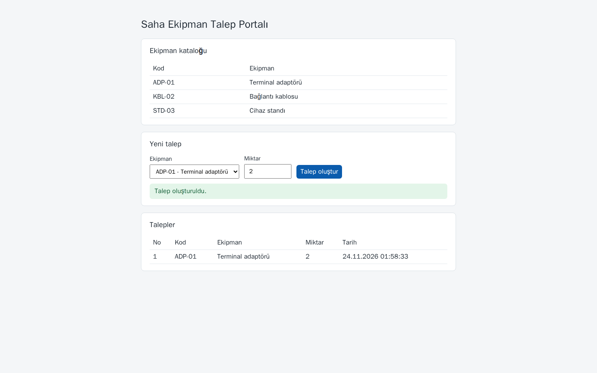

# LAB 01-A · Starter proje, build ve dependency

| | |
|---|---|
| **Gün / modül** | Gün 1 · Modül 3 |
| **Süre** | 70 dk (son 10 dk toparlama ve kontrol) |
| **Başlangıç durumu** | Boş eğitim makinesi; repo henüz klonlanmadı |
| **Takılırsan** | `checkpoint/lab-01a` (bkz. bölüm 9) |

**Öğrenme kazanımı:** Hazır bir projeyi iç GitLab'den alıp lokalde build ve test edebilir, NuGet ve npm bağımlılık ağaçlarını okuyabilir, bir sürüm çakışmasını (NU1605) hata mesajından teşhis edip giderebilirsiniz.

Rehberde adres yazmaz, değişken yazar. Değerler eğitim makinenizde hazırdır; aşağıdakiler prova ortamının örnek değerleridir.

| Değişken | Örnek değer |
|---|---|
| `GITLAB_URL` | `https://gitlab.kurum.test` |
| `TEMPLATE_PROJECT` | `egitim/sablonlar/portal-starter` |
| `NUGET_GROUP_URL` | `https://nexus.kurum.test/repository/nuget-group/index.json` |
| `NPM_GROUP_URL` | `https://nexus.kurum.test/repository/npm-group/` |

## 1. Amaç

Beş gün boyunca kullanacağınız Saha Ekipman Talep Portalı'nı tanımak: klonlamak, derlemek, testlerini çalıştırmak, bağımlılıklarını okumak ve tarayıcıda çalışır halde görmek. Uygulamayı yazmıyoruz; okuyup çalıştırıyoruz.

## 2. Ön koşullar

- Eğitim makinenize bağlandınız ve bir terminal açtınız.
- Araçlar hazır:

  ```bash
  dotnet --version     # 10.0.x
  node --version       # v24.x
  git --version
  ```

- Ortam değişkenleri yüklü: `echo $GITLAB_URL` bir adres yazmalı. Boş geliyorsa eğitmene haber verin.
- Bu lab için GitLab hesabı gerekmez; starter proje herkese açıktır.

## 3. Kullanılacak sistemler

| Sistem | Ne için |
|---|---|
| Eğitim makinesi (terminal) | Bütün komutlar |
| İç GitLab | Starter projeyi klonlamak |
| Nexus | NuGet ve npm paketleri buradan gelir; siz adres yazmazsınız, `NuGet.config` ve `.npmrc` yazar |
| Tarayıcı | Çalışan uygulamayı görmek |

## 4. Adımlar

### Adım 1 · Starter projeyi klonla, klasörleri incele (10 dk)

```bash
cd ~
git clone "$GITLAB_URL/$TEMPLATE_PROJECT.git" saha-ekipman-portal
cd saha-ekipman-portal
git branch -a
tree -L 2 -I 'node_modules|bin|obj' --dirsfirst
```

Commit atabilmek için kimliğinizi bir kez tanıtın:

```bash
git config --global user.name "Adınız Soyadınız"
git config --global user.email "kurum e-posta adresiniz"
```

Şunlara bakın ve eşinizle konuşun:

- `src/` altındaki dört bileşenin her biri ne yapıyor? (`README.md` yardımcı olur.)
- `NuGet.config` ve `src/web-ui/.npmrc` hangi adresi gösteriyor? Neden `nuget.org` ya da `npmjs.org` değil?
- `deploy/` ve `Jenkinsfile` şimdilik neden boş?

### Adım 2 · `dotnet restore`, `build`, `test` (10 dk)

```bash
dotnet restore SahaPortal.sln
dotnet build SahaPortal.sln -c Release --no-restore
dotnet test SahaPortal.sln -c Release --no-build
```

Üç komutu ayrı ayrı çalıştırmamızın nedeni, hangisinin ne ürettiğini görmek. `restore` çıktısında paketlerin nereden geldiğine dikkat edin.

### Adım 3 · `web-ui` içinde `npm ci` ve `npm test` (10 dk)

```bash
cd src/web-ui
npm ci
npm test
cd ../..
```

`npm install` değil `npm ci` kullanıyoruz: `package-lock.json` dosyasına birebir uyar, uymuyorsa durur.

### Adım 4 · NuGet bağımlılık ağacını oku (5 dk)

```bash
dotnet list src/order-service package --include-transitive
```

- "Top-level" altındakiler `.csproj` dosyasında yazanlardır. `src/order-service/order-service.csproj` dosyasını açıp karşılaştırın.
- "Transitive" altındakileri siz yazmadınız. `Microsoft.EntityFrameworkCore` paketini hangi doğrudan bağımlılık getiriyor?

### Adım 5 · npm bağımlılık ağacını incele (5 dk)

```bash
cd src/web-ui
npm ls --depth=0
npm ls react
cd ../..
```

`npm ls react` çıktısındaki `deduped` ne anlama geliyor? React'i kaç paket istiyor, diskte kaç kopya var?

### Adım 6 · `lab/01a-conflict` üzerindeki NU1605 hatasını çöz (15 dk)

```bash
git switch lab/01a-conflict
dotnet restore SahaPortal.sln
```

Restore hata verecek. Mesajı sonuna kadar okuyun ve üç soruyu yanıtlayın:

1. Hangi paket?
2. Hangi iki sürüm isteniyor?
3. İki sürüm hangi iki yoldan geliyor? (Mesajdaki `->` zincirlerini izleyin.)

Sonra `git diff main -- src/order-service/order-service.csproj` ile bu branch'in `main`'den farkına bakın.

Çözmek için iki yol var (slayt "Versiyon çakışması: tanı ve çözüm"):

- **Hizala:** doğrudan referansı, geçişli gelen sürümle aynı yapın.

  ```bash
  dotnet add src/order-service package <paket-adı> -v <sürüm>
  ```

- **Kaldır:** doğrudan referans gereksizse `.csproj` dosyasından silin.

Birini seçin, uygulayın, doğrulayın ve commit edin:

```bash
dotnet restore SahaPortal.sln
dotnet build SahaPortal.sln -c Release --no-restore
dotnet test SahaPortal.sln -c Release --no-build
git add src/order-service/order-service.csproj
git commit -m "fix(order): align EntityFrameworkCore version"
git switch main
```

> Uyarıyı `NoWarn` ile susturmak çözüm değildir: sorunu derleme zamanından çalışma zamanına erteler.

### Adım 7 · API'leri ve web-ui'yi başlat; `/health` ve arayüzü doğrula (5 dk)

Üç terminal açın (üçünde de `cd ~/saha-ekipman-portal`):

```bash
# terminal 1
dotnet run --project src/product-service      # http://localhost:5101

# terminal 2
dotnet run --project src/order-service        # http://localhost:5102

# terminal 3
cd src/web-ui && npm run dev                  # http://localhost:5173
```

Dördüncü bir terminalde:

```bash
curl -s http://localhost:5101/health; echo
curl -s http://localhost:5102/health; echo
curl -s http://localhost:5101/api/products; echo
```

Tarayıcıda `http://localhost:5173` adresini açın: katalogda üç ekipman listelenmeli. Formdan bir ekipman seçip bir talep oluşturun; talep alttaki listeye düşmeli. `http://localhost:5101/swagger` adresinde API sözleşmesine bakın.



İşiniz bitince üç terminalde `Ctrl+C` ile uygulamaları durdurun.

> Tarayıcınız eğitim makinesinde değil de kendi bilgisayarınızdaysa Vite'ı `npm run dev -- --host` ile başlatın ve ortam kartındaki adresi kullanın.

### Toparlama (10 dk)

Bölüm 6'daki listeyi işaretleyin, bölüm 8'deki soruları eşinizle yanıtlayın.

## 5. Beklenen çıktı

`dotnet test` (süreler değişir):

```
Passed!  - Failed:     0, Passed:     5, Skipped:     0, Total:     5 - product-service.tests.dll (net10.0)
Passed!  - Failed:     0, Passed:     4, Skipped:     0, Total:     4 - order-service.tests.dll (net10.0)
```

`npm test`:

```
Tests:       14 passed, 14 total
```

`dotnet list src/order-service package --include-transitive` (kısaltılmış):

```
   Top-level Package                           Requested   Resolved
   > Microsoft.AspNetCore.OpenApi              10.0.15     10.0.15
   > Microsoft.EntityFrameworkCore.Sqlite      10.0.15     10.0.15
   > Swashbuckle.AspNetCore.SwaggerUI          11.0.1      11.0.1

   Transitive Package                                Resolved
   > Microsoft.Data.Sqlite.Core                      10.0.15
   > Microsoft.EntityFrameworkCore                   10.0.15
   > SQLitePCLRaw.core                               2.1.13
   ...
```

`lab/01a-conflict` üzerinde `dotnet restore` (satırlar okunabilirlik için bölündü):

```
error NU1605: Warning As Error: Detected package downgrade:
  Microsoft.EntityFrameworkCore from 10.0.15 to 9.0.23. Reference the package directly from the project to select a different version.
  order-service -> Microsoft.EntityFrameworkCore.Sqlite 10.0.15 -> Microsoft.EntityFrameworkCore.Sqlite.Core 10.0.15 -> ... -> Microsoft.EntityFrameworkCore (>= 10.0.15)
  order-service -> Microsoft.EntityFrameworkCore (>= 9.0.23)
```

`/health` ve katalog:

```
Healthy
Healthy
[{"code":"ADP-01","name":"Terminal adaptörü"},{"code":"KBL-02","name":"Bağlantı kablosu"},{"code":"STD-03","name":"Cihaz standı"}]
```

## 6. Başarı kriterleri

- [ ] `dotnet build` 0 hata; `dotnet test` 9 test geçti.
- [ ] `npm ci` tamamlandı; `npm test` 14 test geçti.
- [ ] `lab/01a-conflict` branch'inde `dotnet restore` artık hata vermiyor; çözümünüz o branch'te commit edildi.
- [ ] İki API'nin `/health` ucu `Healthy` dönüyor.
- [ ] Tarayıcıda katalog listeleniyor ve bir talep oluşturabildiniz.

## 7. Yaygın hatalar ve ipuçları

| Belirti | Olası neden | Ne yapmalı |
|---|---|---|
| `git clone` sırasında `SSL certificate problem: unable to get local issuer certificate` | Makinede kurum CA'sı tanımlı değil | Doğrulamayı kapatmayın. Eğitmene haber verin; CA dosyası `$CA_CERT` yolundadır (2. gün ayrıntısına gireceğiz) |
| `dotnet restore` çok yavaş ya da `NU1301` (kaynağa ulaşılamıyor) | Nexus'a erişim yok | `cat NuGet.config` ile kaynağı, `curl -I "$NUGET_GROUP_URL"` ile erişimi denetleyin |
| `npm ci` `ECONNREFUSED` ya da sertifika hatası | `.npmrc` kaynağına erişilemiyor | `cat src/web-ui/.npmrc`; `echo $NODE_EXTRA_CA_CERTS` boş olmamalı |
| `npm ci` "lock file out of sync" | `package.json` elle değiştirilmiş | `git status` ile bakın, değişikliği geri alın: `git restore src/web-ui/package.json` |
| Adım 6'da restore hâlâ `NU1605` veriyor | Yanlış paket ya da yanlış sürüm hizalandı | Hata mesajındaki "from … to …" sürümlerine yeniden bakın |
| `Failed to bind to address http://127.0.0.1:5101: address already in use` | Uygulama başka bir terminalde zaten çalışıyor | Eski terminalde `Ctrl+C`; ya da `pkill -u $USER -f product-service` |
| Arayüz açılıyor ama "Veriler yüklenemedi" | API'lerden biri çalışmıyor | 1. ve 2. terminale bakın; `curl http://localhost:5102/health` |
| `git commit` "Please tell me who you are" diyor | Git kimliği tanımlı değil | Adım 1'deki iki `git config` komutu |

## 8. Kendini kontrol soruları

1. `npm ci` ile `npm install` arasındaki en önemli fark nedir; CI'da neden `npm ci` kullanılır?
2. `Microsoft.EntityFrameworkCore` paketini `.csproj` dosyasına siz yazmadınız. Projeye nasıl girdi ve bunu hangi komutla gösterirsiniz?
3. NU1605'i "hizalayarak" ve "kaldırarak" çözmenin farkı nedir? Altı ay sonra `Microsoft.EntityFrameworkCore.Sqlite` güncellendiğinde hangisi yeniden bakım ister?

## 9. Başlangıç durumuna dönme

**Laba baştan başlamak:**

```bash
cd ~ && rm -rf saha-ekipman-portal
```

Sonra Adım 1'den devam edin. Paket önbellekleri (`~/.nuget`, `~/.npm`) durduğu için ikinci kurulum hızlıdır.

**Takıldıysanız (`checkpoint/lab-01a`):** bu branch, çakışmanın çözülmüş halidir. Kendi çözümünüzle karşılaştırın ya da yerine alın:

```bash
git diff lab/01a-conflict origin/checkpoint/lab-01a        # fark
git switch -C lab/01a-conflict origin/checkpoint/lab-01a   # çözülmüş hali al
dotnet restore SahaPortal.sln
git switch main
```

LAB 01-B `main` branch'inden başlar; `main` üzerinde çakışma yoktur.
