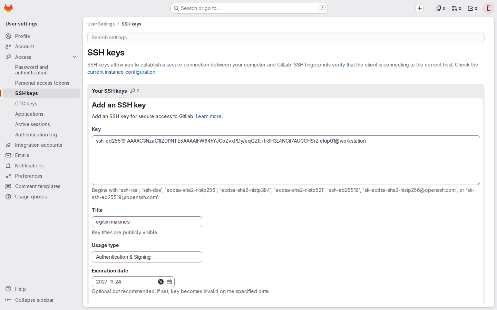
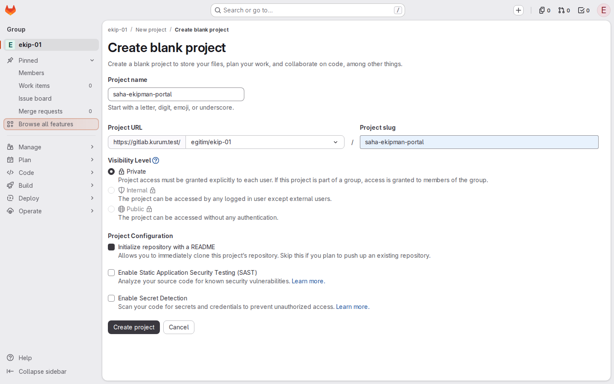
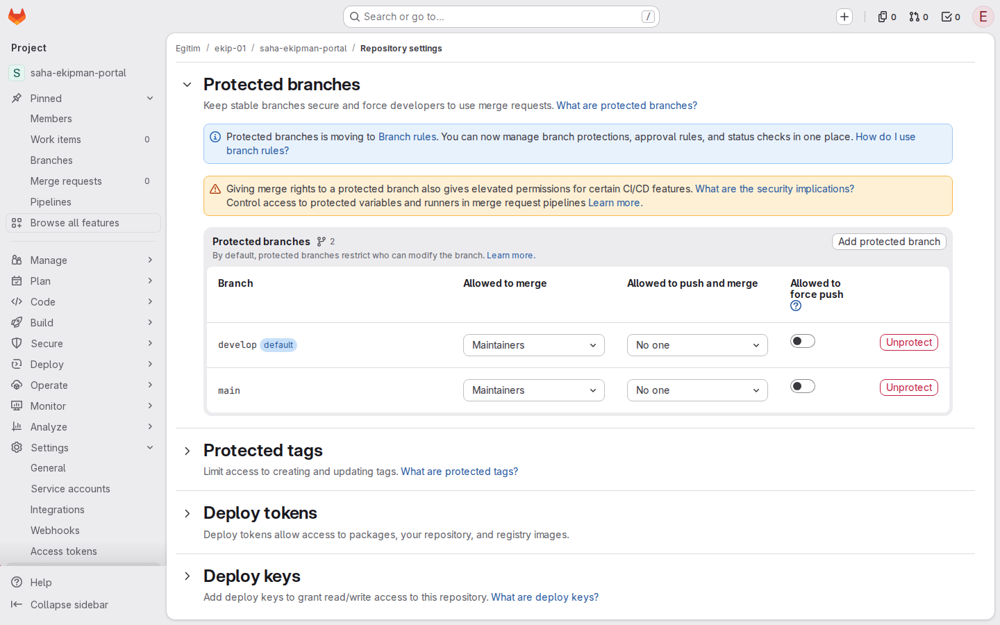
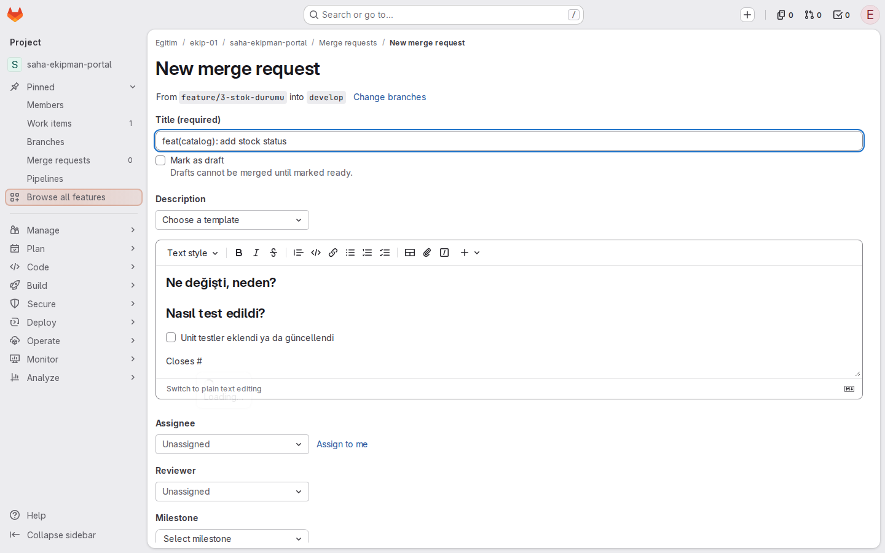
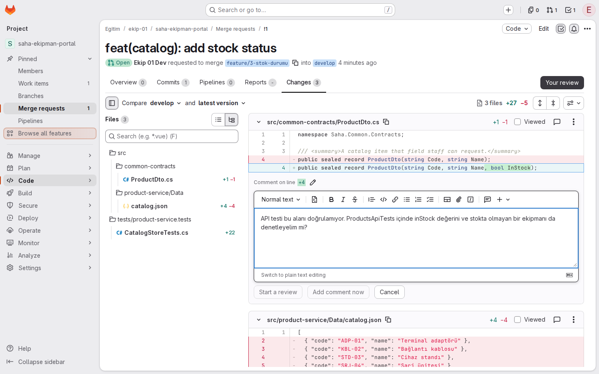
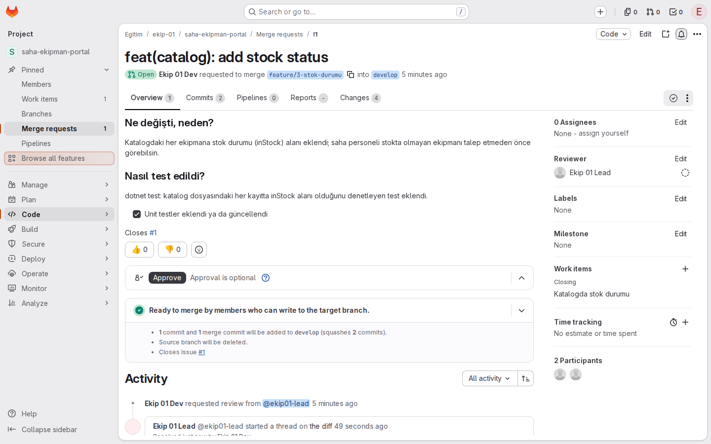
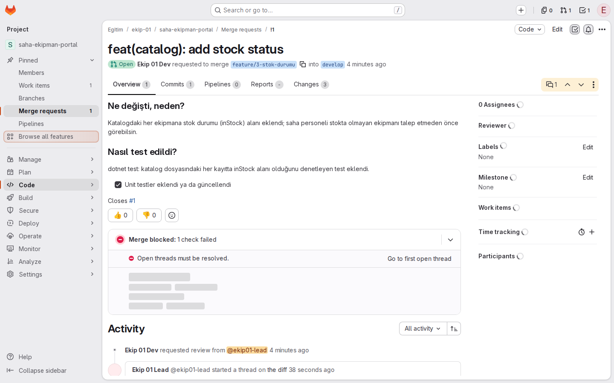

# LAB 02-A · Proje, koruma ve Merge Request

| | |
|---|---|
| **Gün / modül** | Gün 2 · Modül 2 |
| **Süre** | 80 dk (son 10 dk toparlama ve kontrol) |
| **Başlangıç durumu** | `checkpoint/gun1`: lokal repoda `feature/katalog-sarj-unitesi` branch'i, conflict çözülmüş, testler yeşil |
| **Takılırsan** | Eğitmen ekibinizi `checkpoint/lab-02a` durumuna getirir (bkz. bölüm 9) |

**Öğrenme kazanımı:** Lokal bir repoyu GitLab'de ekip projesine taşıyabilir, `main` ve `develop` branch'lerini koruyabilir, bir değişikliği issue → branch → Merge Request → review → merge zinciriyle teslim edebilirsiniz.

İkili çalışın. Bu labda iki rol var ve her rol kendi GitLab hesabını kullanır:

| Rol | Hesap | GitLab rolü | Ne yapar |
|---|---|---|---|
| **Lider / reviewer** | `ekipNN-lead` | Maintainer | Projeyi oluşturur, korur, inceler, merge eder |
| **Yazar** | `ekipNN-dev` | Developer | Issue açar, kodu yazar, MR açar, yorumları giderir |

Örnek değerler (prova ortamı, ekip-01):

| Değişken | Örnek değer |
|---|---|
| `GITLAB_URL` | `https://gitlab.kurum.test` |
| `GITLAB_HOST` | `gitlab.kurum.test` |
| `GITLAB_GROUP` | `egitim` |
| Ekip grubu | `egitim/ekip-01` |
| Ekip projesi | `egitim/ekip-01/saha-ekipman-portal` |

> **Akış:** push kapalı, merge yalnızca Maintainer. Böylece her değişiklik ikinci bir kişiden geçer. Onay kuralları (approval rules) ve Code Owners GitLab'in ücretli katmanlarındadır; bu labda kullanılmaz.

## 1. Amaç

Dün tek makinede duran repo bugün ekibin ortak projesi oluyor. Kuralı "dikkat edelim" diye değil, GitLab ayarı olarak koyacaksınız: kimse `main` ve `develop`'a doğrudan yazamayacak, her değişiklik ikinci bir kişiden geçecek.

## 2. Ön koşullar

- Dünkü çıktı hazır: `cd ~/saha-ekipman-portal && git log --oneline --graph -n 4` çıktısında `feature/katalog-sarj-unitesi` üzerindeki merge commit'i görünüyor. Yoksa bölüm 9'a bakın.
- İki eş de GitLab'e kendi hesabıyla giriş yapabiliyor (`$GITLAB_URL`).
- **SSH anahtarınız GitLab profilinizde kayıtlı.** Değilse şimdi ekleyin:

  ```bash
  ls ~/.ssh/id_ed25519.pub || ssh-keygen -t ed25519 -C "$USER"
  cat ~/.ssh/id_ed25519.pub
  ```

  GitLab'de sağ üstteki avatar > **Edit profile** > **SSH Keys** > **Add new key**: açık anahtarı **Key** alanına yapıştırın, **Add key**.

  

  ```bash
  ssh -T git@$GITLAB_HOST
  # Welcome to GitLab, @ekip01-dev!
  ```

> **Prova ortamında (sandbox) iki eş aynı makineyi paylaşıyorsa:** terminalde hangi hesapla çalıştığınızı `rol lead` ya da `rol dev` komutuyla seçin. Komut, git'in kullanacağı SSH anahtarını ve commit kimliğini o terminal için ayarlar. Lider için ikinci anahtar `~/.ssh/id_ed25519_lead.pub` dosyasındadır; onu `ekipNN-lead` hesabının profiline ekleyin. Herkesin kendi makinesi varsa `rol` komutuna gerek yoktur.

## 3. Kullanılacak sistemler

| Sistem | Ne için |
|---|---|
| Eğitim makinesi (terminal, editör) | Git komutları, kod değişikliği, testler |
| İç GitLab (tarayıcı) | Proje, koruma ayarları, issue, Merge Request |

## 4. Adımlar

### Adım 1 · Lokal repoyu ekip grubundaki projeye push et (15 dk) — *lider*

**1a. Dünkü işi `main`'e alın.** Koruma henüz yok; bu, `main`'e doğrudan yaptığınız son değişiklik olacak.

```bash
cd ~/saha-ekipman-portal
git switch main
git merge --no-ff feature/katalog-sarj-unitesi -m "Merge branch 'feature/katalog-sarj-unitesi'"
```

**1b. MR şablonunu ve CODEOWNERS dosyasını ekleyin.** İkisi de repoda yaşar; kural kodla birlikte sürümlenir.

```bash
mkdir -p .gitlab/merge_request_templates
```

`.gitlab/merge_request_templates/Default.md` (slayt "CODEOWNERS ve MR şablonu"):

```markdown
## Ne değişti, neden?

## Nasıl test edildi?

- [ ] Unit testler eklendi ya da güncellendi

Closes #
```

`.gitlab/CODEOWNERS` dosyasını slayttaki örneğe göre yazın: üç bölüm (`[Backend]`, `[Frontend]`, `[Pipeline]`), her satırda bir yol ve bir sahip. Sahip olarak ekip grubunuzu (`@egitim/ekip-NN`), `Jenkinsfile` için ekip liderinizi (`@ekipNN-lead`) yazın. Slayttaki `backend` / `frontend` alt grupları eğitim ortamında yoktur.

```bash
git add .gitlab
git commit -m "chore: add merge request template and CODEOWNERS"
```

**1c. Projeyi oluşturun.** GitLab'de ekip grubunuzu açın (`$GITLAB_URL/$GITLAB_GROUP/ekip-NN`) > **Create project** > **Create blank project**:

- **Project name:** `saha-ekipman-portal`
- **Visibility Level:** Private
- **Initialize repository with a README:** işareti **kaldırın** (repo sizde hazır)



**1d. Push edin.** Klonladığınız starter proje `sablon` adıyla kalsın; `origin` artık ekip projeniz.

```bash
git remote rename origin sablon
git remote add origin "git@$GITLAB_HOST:$GITLAB_GROUP/ekip-$EKIP/saha-ekipman-portal.git"
git push -u origin main
git remote -v
```

### Adım 2 · `develop`'u oluştur; `main` ve `develop`'u koru (15 dk) — *lider*

```bash
git switch -c develop
git push -u origin develop
```

GitLab'de proje > **Settings > Repository**:

1. **Branch defaults:** varsayılan branch'i `develop` yapın, **Save changes**. (MR şablonu ve "Closes #" ile issue kapatma varsayılan branch'e göre çalışır; GitFlow'da günlük iş `develop`'a akar.)
2. **Protected branches:** `main` zaten listededir (GitLab ilk push'ta varsayılan branch'i korur). İki branch için de şu tabloyu kurun; `develop` için **Add protected branch** kullanın.

   | Branch | Allowed to merge | Allowed to push and merge |
   |---|---|---|
   | `main` | Maintainers | No one |
   | `develop` | Maintainers | No one |

   

3. **Settings > Merge requests:** *Merge method* "Merge commit" kalsın; *Merge checks* altında **All threads must be resolved** kutusunu işaretleyin, **Save changes**. ("Pipelines must succeed" kutusunu 4. gün açacağız.)

**Kontrol: doğrudan push reddediliyor mu?** İki eş de kendi hesabıyla denesin:

```bash
git switch develop
git commit --allow-empty -m "test: direct push"
git push origin develop          # reddedilmeli
git reset --hard origin/develop  # deneme commit'ini geri al
```

Push reddedildiyse yanlış bir şey yapmadınız: koruma çalışıyor.

### Adım 3 · Issue aç; `feature/3-stok-durumu` branch'ini oluştur (5 dk) — *yazar*

GitLab'de proje > **Plan > Issues > New issue**:

- **Title:** `Katalogda stok durumu`
- **Description:** ihtiyacı ve kabul kriterini yazın. Örnek: *"Saha personeli bir ekipmanın stokta olup olmadığını katalogda görebilmeli. Kabul kriteri: `GET /api/products` yanıtında her ekipman için `inStock` alanı bulunur."*

Issue numarasını not edin.

> **Numara hakkında:** slaytlarda bu issue `#3` olarak geçer; o bir örnektir. GitLab issue'ları her projede 1'den numaralar, sizinki büyük olasılıkla `#1` olacaktır. Eğitimde herkes aynı adı kullansın diye branch adını slayttaki gibi `feature/3-stok-durumu` bırakıyoruz; MR'da **kendi** issue numaranızı yazacaksınız. Gerçek projede branch adındaki numara ile issue numarası aynı olur.

```bash
git switch develop && git pull
git switch -c feature/3-stok-durumu
```

### Adım 4 · Kataloğa "stok durumu" alanını ekle, testi güncelle (15 dk) — *yazar*

Hedef: `GET /api/products` her ekipman için `inStock` (true/false) döndürsün.

- `src/product-service/Data/catalog.json`: her kayda `"inStock"` alanını ekleyin. `STD-03` stokta olmasın (`false`), diğerleri `true`.
- `src/common-contracts/ProductDto.cs`: kayda (record) bir `bool InStock` alanı ekleyin.
- `tests/product-service.tests/CatalogStoreTests.cs`: yeni alanı denetleyen bir test yazın. İpucu: JSON'da alan hiç yoksa `bool` sessizce `false` okunur; "her kayıtta alan var mı?" sorusunu dosyanın kendisine sorun.

```bash
dotnet test SahaPortal.sln
git add src tests
git commit -m "feat(catalog): add stock status"
git push -u origin feature/3-stok-durumu
```

### Adım 5 · `develop` hedefli MR aç, şablonu doldur (5 dk) — *yazar*

Push çıktısındaki bağlantıyı açın ya da proje > **Code > Merge requests > New merge request**: kaynak `feature/3-stok-durumu`, hedef `develop`.

- **Title:** Conventional Commits biçiminde, örneğin `feat(catalog): add stock status`. Squash'ta commit mesajı bu başlık olur.
- **Description:** şablon kendiliğinden gelir. İki başlığı doldurun; son satırı kendi issue numaranızla tamamlayın: `Closes #1`.
- **Reviewer:** eşiniz.
- **Delete source branch…** ve **Squash commits…** kutuları işaretli olsun (feature MR'larında squash açık).



MR açıldığında yazarın ekranında şu satırı arayın: *"Ready to merge by members who can write to the target branch."* Merge düğmesi sizde yok: merge yalnızca Maintainer'da.

### Adım 6 · Reviewer yorum yazsın; düzelt, thread'i çöz (10 dk)

**Reviewer (lider):** MR'ı açın > **Changes** sekmesi. Dört şeye bakın: doğruluk, test, okunabilirlik, güvenlik. Bir satırın üzerine gelip beliren yorum düğmesine tıklayın, önerinizi gerekçesiyle yazın, **Add comment now**. En az bir yorum bırakın; örneğin: *"API testi bu alanı doğrulamıyor. `ProductsApiTests` içinde `inStock` değerini ve stokta olmayan bir ekipmanı da denetleyelim mi?"*



Şimdi **Overview** sekmesine dönün: lider olduğunuz halde merge edemezsiniz. *"Merge blocked: 1 check failed — Open threads must be resolved."*

**Yazar:** yorumu giderin, yeni bir commit olarak gönderin (geçmişi yeniden yazmayın):

```bash
# düzeltmeyi yapın, sonra:
dotnet test SahaPortal.sln
git add tests
git commit -m "test(catalog): cover stock status in the products API"
git push
```

MR sayfasında yorumu yanıtlayın ve **Resolve thread** ile kapatın.

### Adım 7 · Merge et; branch silindi, issue kapandı mı? (5 dk) — *lider*

MR'da **Merge**. Sonra üç şeyi denetleyin:

1. MR "Merged" durumunda; merge eden kişi yazardan farklı.
2. **Code > Branches:** `feature/3-stok-durumu` artık yok.
3. **Plan > Issues:** issue kapandı ve MR'a bağlantı veriyor.

İki eş de yerelini güncellesin:

```bash
git switch develop && git pull
git fetch --prune
git branch -D feature/3-stok-durumu      # squash sonrası -d "not fully merged" der; -D gerekir
git log --oneline --graph -n 6
```

### Zaman kalırsa · Rolleri değiştirin: ikinci küçük MR

Eğitmenden ekibinizin rollerini değiştirmesini isteyin (bir komutla yapar; yalnızca sizin ekibinizi etkiler). Artık dünkü lider Developer, dünkü yazar Maintainer.

Yeni yazar küçük bir değişiklik yapsın: katalog tablosunda stok durumunu gösterin.

- Branch: `feature/3-stok-durumu-arayuz` (`develop`'tan)
- `src/web-ui/src/components/CatalogList.jsx`: tabloya bir "Stok" sütunu; değer `Stokta` ya da `Stokta yok`
- `CatalogList.test.jsx`: yeni sütun için bir test; `npm test`
- MR başlığı: `feat(web-ui): show stock status`; açıklamada `İlgili: #1` (issue zaten kapalı)

Yeni reviewer inceleyip **Approve** ve **Merge** etsin. İş bitince eğitmen rolleri eski haline döndürür.

### Toparlama (10 dk)

Bölüm 6'yı işaretleyin; bölüm 8'i eşinizle yanıtlayın.

## 5. Beklenen çıktı

Korumalı branch'e doğrudan push:

```
$ git push origin develop
remote: GitLab: You are not allowed to push code to protected branches on this project.
To gitlab.kurum.test:egitim/ekip-01/saha-ekipman-portal.git
 ! [remote rejected] develop -> develop (pre-receive hook declined)
error: failed to push some refs to 'gitlab.kurum.test:egitim/ekip-01/saha-ekipman-portal.git'
```

Yazarın MR ekranı (Developer):



Çözülmemiş thread varken liderin MR ekranı:



Merge'den sonra `git log --oneline --graph -n 6` (kimlikler sizde farklıdır):

```
*   265d5ee Merge branch 'feature/3-stok-durumu' into 'develop'
|\
| * 6ea71d3 feat(catalog): add stock status
|/
* a554780 chore: add merge request template and CODEOWNERS
*   fb33620 Merge branch 'feature/katalog-sarj-unitesi'
```

İki commit'iniz squash ile tek commit'e indi; onu `develop`'a bir merge commit'i bağladı.

## 6. Başarı kriterleri

- [ ] Proje ekip grubunda; varsayılan branch `develop`.
- [ ] `main` ve `develop` korumalı: push "No one", merge "Maintainers".
- [ ] Doğrudan push hem Developer hem Maintainer için reddediliyor.
- [ ] Bir MR ikinci kişinin incelemesinden geçti: en az bir thread açıldı ve çözüldü.
- [ ] MR'ı yazar değil, Maintainer merge etti.
- [ ] Kaynak branch silindi, issue kapandı.
- [ ] `develop` üzerinde `dotnet test` yeşil.

## 7. Yaygın hatalar ve ipuçları

| Belirti | Olası neden | Ne yapmalı |
|---|---|---|
| `You are not allowed to push code to protected branches on this project` | Korumalı branch'e doğrudan push | Hata değil, koruma. Feature branch açın, MR ile gönderin |
| `Permission denied (publickey)` | SSH anahtarı GitLab profilinde yok ya da yanlış hesapta | Bölüm 2; `ssh -T git@$GITLAB_HOST` hangi hesabı selamlıyor? |
| `! [rejected] (non-fast-forward)` | Uzak branch'te sizde olmayan commit var | `git pull --rebase`, sonra push. `--force` çözüm değildir |
| MR açarken şablon gelmiyor | Şablon varsayılan branch'te değil ya da varsayılan branch hâlâ `main` ve dosya orada yok | Dosya yolu `.gitlab/merge_request_templates/Default.md` mı? Adım 2.1'i yaptınız mı? |
| Merge'den sonra issue kapanmadı | `Closes #N` yazılmadı, numara yanlış ya da hedef branch varsayılan branch değil | MR açıklamasını ve Adım 2.1'i denetleyin; issue'yu elle kapatın |
| Merge düğmesi yok | Hesabınız Developer | Doğru: merge yalnızca Maintainer'da |
| Merge düğmesi yerine "Merge blocked" | Açık thread, conflict ya da Draft | MR ekranı engeli adıyla söyler; onu giderin |
| `git branch -d` "not fully merged" diyor | MR squash ile merge edildi; commit'leriniz `develop`'ta başka kimlikle duruyor | `git branch -D` |
| İlk push reddedildi (`rejected`, `fetch first`) | Proje README ile oluşturulmuş olabilir; geçmişler farklı | Projeyi silip README'siz yeniden oluşturun (eğitmene sorun) |

## 8. Kendini kontrol soruları

1. Korumalı branch'e doğrudan push neden Maintainer için de kapalı? "Allowed to merge: Maintainers" ile birlikte bu neyi garanti eder?
2. "Dört göz" ilkesini bir denetçiye nasıl kanıtlarsınız? MR sayfasında hangi iki bilgiye bakar?
3. Feature MR'ında squash'ı açtık. Squash'tan sonra `git log`'da ne kayboldu, ne kaldı? MR başlığını neden Conventional Commits biçiminde yazdık?

## 9. Başlangıç durumuna dönme

**Lokal repoda geri dönmek** (push etmediğiniz iş için): `git switch develop && git branch -D feature/3-stok-durumu`.

**Laba baştan başlamak ya da `checkpoint/lab-02a`'ya geçmek:** GitLab'deki proje, korumalar ve MR'lar ortak durumdur; bunları eğitmen kurar ya da sıfırlar. Eğitmene ekip numaranızı söyleyin:

- *Baştan:* eğitmen ekibinizi sıfırlar; projeniz silinir, lokal repoyu `checkpoint/gun1`'den yeniden kurarsınız.
- *`checkpoint/lab-02a`:* eğitmen ekibinizi bu labın sonundaki duruma getirir. Proje, korumalar ve kod hazır olur; **MR ve yorum geçmişi geri gelmez**. Eski çalışma kopyanız `~/yedek/` altına taşınır.

Checkpoint'in kodunu kendi çözümünüzle karşılaştırmak için:

```bash
git fetch sablon
git diff origin/develop sablon/checkpoint/lab-02a --stat
```
