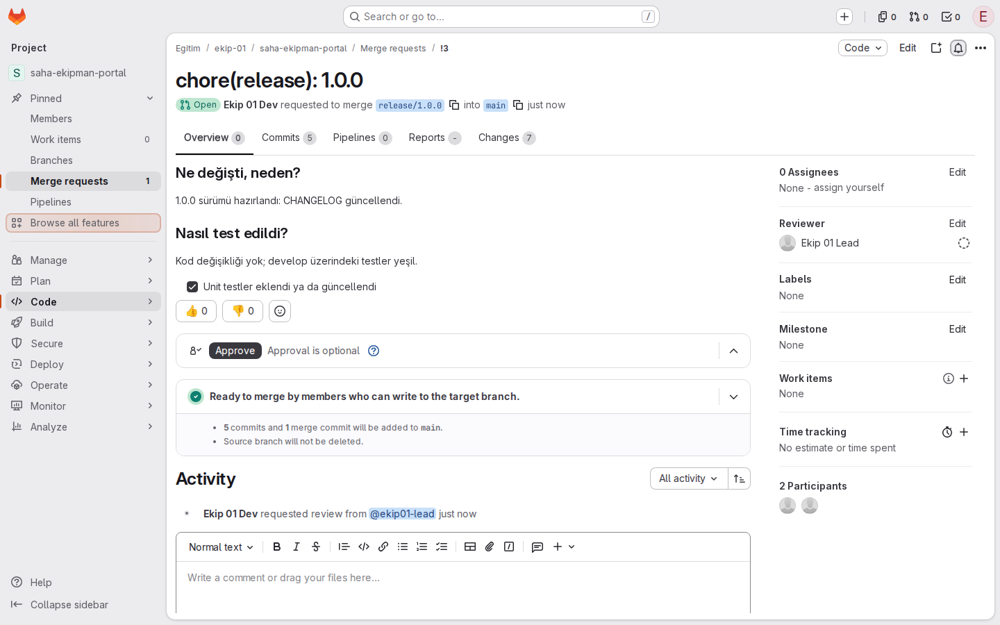
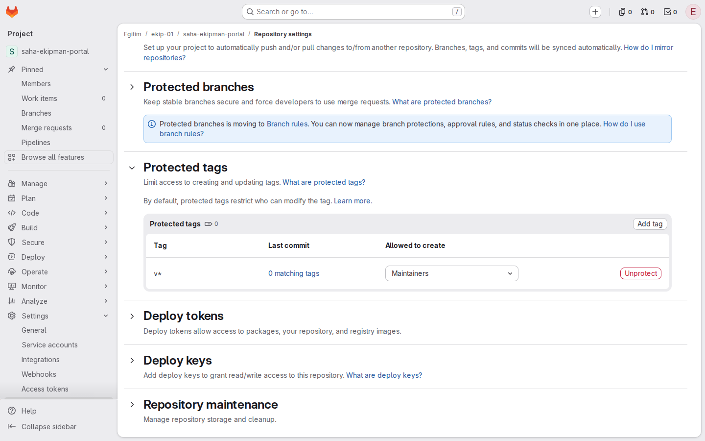
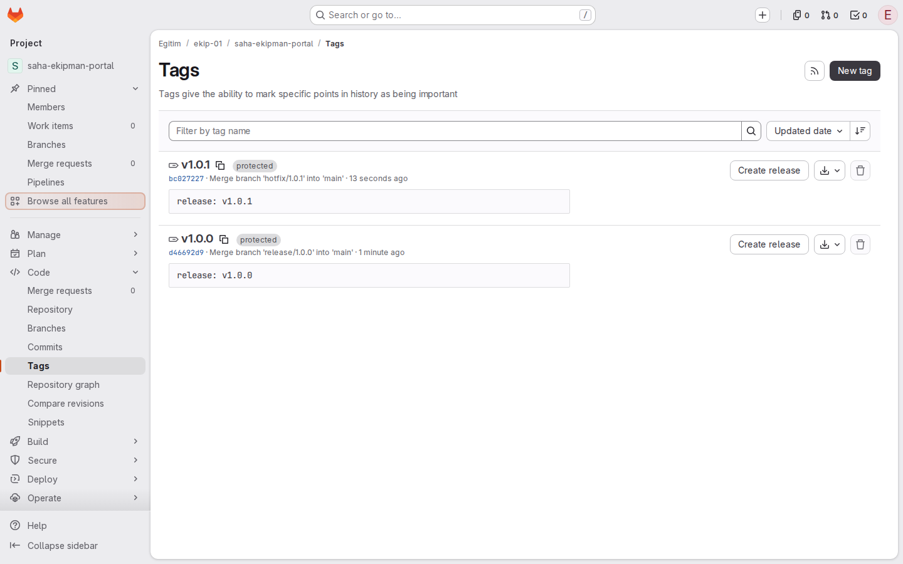

# LAB 02-B · Release ve hotfix döngüsü

| | |
|---|---|
| **Gün / modül** | Gün 2 · Modül 4 |
| **Süre** | 80 dk: ilk 40 dk release, sonraki 30 dk hotfix, son 10 dk toparlama |
| **Başlangıç durumu** | `checkpoint/lab-02a`: ekip projesi GitLab'de, `main` ve `develop` korumalı, stok durumu `develop`'ta |
| **Takılırsan** | `git log --oneline --graph origin/main origin/develop` çıktısı GitFlow şemasına benzemeli. Eğitmen ekibinizi `checkpoint/lab-02b` durumuna getirebilir (bkz. bölüm 9) |

**Öğrenme kazanımı:** GitFlow ile bir sürüm çıkarabilir (release branch'i, CHANGELOG, annotated tag), yayındaki bir hatayı hotfix branch'iyle düzeltebilir ve düzeltmenin hem `main`'e hem `develop`'a ulaştığını gösterebilirsiniz.

Roller LAB 02-A'daki gibi: **yazar** (`ekipNN-dev`, Developer) branch'leri ve MR'ları hazırlar; **lider** (`ekipNN-lead`, Maintainer) merge eder ve tag'leri atar.

Örnek değerler (prova ortamı, ekip-01): `GITLAB_URL=https://gitlab.kurum.test`, ekip projesi `egitim/ekip-01/saha-ekipman-portal`.

## 1. Amaç

`develop`'ta biriken işi `v1.0.0` olarak yayınlamak; ardından yayındaki bir hatayı (boş ekipman koduyla talep açılabiliyor) `v1.0.1` hotfix'i olarak düzeltmek. Gün sonunda grafiğiniz slayttaki GitFlow şemasının aynısı olacak.

## 2. Ön koşullar

- LAB 02-A tamam: `git switch develop && git pull` hatasız; `git log --oneline -n 3` çıktısında stok durumu merge'ü var.
- İki eş de GitLab'e kendi hesabıyla giriş yapabiliyor; SSH anahtarları kayıtlı.

## 3. Kullanılacak sistemler

| Sistem | Ne için |
|---|---|
| Eğitim makinesi (terminal, editör) | Branch, commit, tag, testler |
| İç GitLab (tarayıcı) | Merge Request'ler, korumalı tag, issue |

Bu labda dört MR açacaksınız. Hepsinde **Squash kapalı** olacak: sürüme giren commit'lerin izi korunmalı.

| # | Kaynak → hedef | Kaynak branch silinsin mi? |
|---|---|---|
| 1 | `release/1.0.0` → `main` | Hayır (birazdan `develop`'a da gidecek) |
| 2 | `release/1.0.0` → `develop` | Evet |
| 3 | `hotfix/1.0.1` → `main` | Hayır |
| 4 | `hotfix/1.0.1` → `develop` | Evet |

## 4. Adımlar

### Adım 1 · `release/1.0.0` branch'ini `develop`'tan aç (5 dk) — *yazar*

```bash
cd ~/saha-ekipman-portal
git switch develop && git pull
git switch -c release/1.0.0
```

Release branch'i yalnızca sürüm hazırlığı ve son düzeltmeler içindir; yeni özellik girmez.

### Adım 2 · CHANGELOG'u güncelle; MR ile `main`'e merge et (15 dk)

**Yazar:** `CHANGELOG.md` dosyasında `## [Unreleased]` başlığının altına `1.0.0` bölümünü ekleyin ("Keep a Changelog" biçimi):

```markdown
## [1.0.0] - <bugünün tarihi, YYYY-AA-GG>

### Added

- <bu sürümde gelen iki değişiklik, birer satır>
```

Hangi iki değişiklik? `git log --oneline sablon/main..develop` size söyler. Bir issue'ya bağlı olanın sonuna issue numarasını yazın: `(#1)`.

```bash
git add CHANGELOG.md
git commit -m "chore(release): 1.0.0"
git push -u origin release/1.0.0
```

GitLab'de MR açın: `release/1.0.0` → **`main`** (hedef varsayılan olarak `develop` gelir; değiştirin). Başlık `chore(release): 1.0.0`. **Squash** ve **Delete source branch** kutuları **işaretsiz** olsun.



**Lider:** MR'ı inceleyin ve **Merge** edin.

### Adım 3 · `main` üzerinde `v1.0.0` annotated tag'ini at, push et (10 dk)

**Lider — önce tag'i koruyun.** Proje > **Settings > Repository > Protected tags** > **Add tag**: *Tag* alanına `v*` yazıp **Create wildcard** seçin, *Allowed to create* **Maintainers**, **Protect**.



**Yazar — deneyin (reddedilmeli):**

```bash
git switch main && git pull
git tag -a v1.0.0 -m "release: v1.0.0"
git push origin v1.0.0       # Developer: reddedilir
git tag -d v1.0.0            # yerel tag'i silin
```

**Lider — tag'i atın:**

```bash
git switch main && git pull
git tag -a v1.0.0 -m "release: v1.0.0"
git push origin v1.0.0
git describe --tags
```

`-a` ile atılan tag kim, ne zaman, neden bilgisini taşır. GitLab'de **Code > Tags** sayfasında görün.

> **Ara kontrol (40. dakika):** herkesin `v1.0.0` tag'i GitLab'de görünüyor olmalı.

### Adım 4 · Release branch'ini `develop`'a geri merge et (5 dk)

**Yazar:** ikinci MR: `release/1.0.0` → `develop`. Başlık örneği: `chore(release): merge 1.0.0 back into develop`. Squash kapalı; bu kez **Delete source branch** işaretli.

**Lider:** merge edin.

Neden? Release sırasında yapılan değişiklikler (burada CHANGELOG) `develop`'a dönmezse bir sonraki sürümde kaybolur.

### Adım 5 · `hotfix/1.0.1` aç: boş ekipman kodu hatasını düzelt (20 dk) — *yazar*

Senaryo: `v1.0.0` yayında. Arayüzde ekipman seçmeden "Talep oluştur"a basınca talep kaydediliyor. `develop`'ta ise yayınlanmamış işler olabilir; bu yüzden düzeltme `develop`'tan değil, **yayındaki koddan** çıkar.

Önce GitLab'de hatayı kaydedin: **Plan > Issues > New issue**, başlık `Boş ekipman koduyla talep açılabiliyor`. Numarasını not edin (büyük olasılıkla `#2`).

```bash
git fetch --tags origin
git switch -c hotfix/1.0.1 v1.0.0
```

**Önce testi yazın.** `tests/order-service.tests/OrdersApiTests.cs` dosyasına, boş (`""`) ve yalnızca boşluktan oluşan (`"   "`) `productId` ile gönderilen talebin `400 Bad Request` döndüğünü doğrulayan bir test ekleyin. Mevcut `Post_order_returns_201_with_the_created_order` testi iyi bir kalıptır; iki değeri tek testte denemek için `[Theory]` ve `[InlineData]` kullanın.

```bash
dotnet test tests/order-service.tests      # yeni test KIRMIZI olmalı: hata gerçekten var
```

**Sonra düzeltin.** `src/order-service/Endpoints/OrderEndpoints.cs` içinde `CreateAsync`'in başına tek koşul: `productId` boşsa kaydetmeden `400` dönün (`Results.BadRequest(...)`). Yanıt gövdesine arayüzün gösterebileceği bir `error` metni koyun.

```bash
dotnet test SahaPortal.sln                 # hepsi yeşil
git add src tests
git commit -m "fix(order): reject empty product id"
```

CHANGELOG'a `1.0.1` bölümünü ekleyin (`### Fixed` başlığı altında tek satır, issue numarasıyla), ayrı bir commit olarak:

```bash
git add CHANGELOG.md
git commit -m "chore(release): 1.0.1"
git push -u origin hotfix/1.0.1
```

### Adım 6 · MR ile `main`'e merge et, `v1.0.1` tag'ini at (10 dk)

**Yazar:** üçüncü MR: `hotfix/1.0.1` → **`main`**. Başlık `fix(order): reject empty product id`; açıklamada `Closes #2`. Squash ve Delete source branch **işaretsiz**.

**Lider:** merge edin, sonra tag'i atın:

```bash
git switch main && git pull
git tag -a v1.0.1 -m "release: v1.0.1"
git push origin v1.0.1
```

Issue hâlâ açık mı? Bakın; nedenini Adım 7'den sonra konuşun.

### Adım 7 · Hotfix'i `develop`'a da merge et; grafiği doğrula (5 dk)

**Yazar:** dördüncü MR: `hotfix/1.0.1` → `develop`; açıklamada `Closes #2`; **Delete source branch** işaretli. **Lider:** merge edin.

İki eş de:

```bash
git fetch --prune --tags origin
git switch develop && git pull
git log --oneline --graph origin/main origin/develop
git tag -l 'v*'
```

Düzeltme commit'inin iki yerde de olduğunu gösterin:

```bash
git branch -r --contains "$(git log --no-merges --format=%H --grep='^fix(order)' -n 1 origin/main)"
```

### Toparlama (10 dk)

GitLab'de **Code > Tags** ve **Merge requests > Merged** sayfalarını açın: iki tag, altı MR (bu labın dördü ve LAB 02-A'dakiler). Bölüm 6'yı işaretleyin; bölüm 8'i yanıtlayın. Yerel `release/1.0.0` ve `hotfix/1.0.1` branch'lerini silebilirsiniz (`git branch -D`).

## 5. Beklenen çıktı

Developer korumalı tag'i gönderemez:

```
$ git push origin v1.0.0
remote: GitLab: You are not allowed to create this tag as it is protected.
To gitlab.kurum.test:egitim/ekip-01/saha-ekipman-portal.git
 ! [remote rejected] v1.0.0 -> v1.0.0 (pre-receive hook declined)
```

Maintainer:

```
$ git push origin v1.0.0
 * [new tag]         v1.0.0 -> v1.0.0
$ git describe --tags
v1.0.0
```

Adım 5, düzeltmeden önce (kısaltılmış):

```
Failed SahaPortal.OrderService.Tests.OrdersApiTests.Post_order_without_a_product_id_returns_400(productId: "")
  Assert.Equal() Failure: Values differ
  Expected: BadRequest
  Actual:   Created
Failed!  - Failed:     2, Passed:     4, Skipped:     0, Total:     6 - order-service.tests.dll (net10.0)
```

Adım 7 grafiği (kimlikler sizde farklıdır):

```
*   ac9504a Merge branch 'hotfix/1.0.1' into 'develop'
|\
* \   67c4184 Merge branch 'release/1.0.0' into 'develop'
|\ \
| | | *   bc02722 Merge branch 'hotfix/1.0.1' into 'main'          <- v1.0.1
| | | |\
| | | |/
| | |/|
| | * | 2ddb896 chore(release): 1.0.1
| | * | e2a876e fix(order): reject empty product id
| | |/
| | *   d46692d Merge branch 'release/1.0.0' into 'main'           <- v1.0.0
| | |\
| | |/
| |/|
| * | ec6ed8f chore(release): 1.0.0
|/ /
*   9a4da9a Merge branch 'feature/3-stok-durumu-arayuz' into 'develop'
```

```
$ git branch -r --contains e2a876e
  origin/develop
  origin/main
```



## 6. Başarı kriterleri

- [ ] GitLab'de `v1.0.0` ve `v1.0.1` tag'leri var; ikisi de annotated ve `main` üzerinde.
- [ ] `v*` korumalı tag; Developer oluşturamıyor.
- [ ] `main` üzerindeki `CHANGELOG.md` dosyasında `1.0.0` ve `1.0.1` bölümleri var.
- [ ] Hotfix commit'i hem `origin/main` hem `origin/develop` içinde.
- [ ] Dört MR da merge edildi; hiçbiri squash edilmedi.
- [ ] `v1.0.1`'de boş ekipman koduyla talep `400`, geçerli talep `201` dönüyor.

## 7. Yaygın hatalar ve ipuçları

| Belirti | Olası neden | Ne yapmalı |
|---|---|---|
| `You are not allowed to create this tag as it is protected` | Tag'i Developer hesabı gönderiyor | Tag'i lider atar. Hata değil, koruma |
| MR `develop`'a açıldı, `main` olacaktı | Hedef varsayılan branch'ten gelir | MR'da **Edit** > hedef branch'i değiştirin |
| Release MR'ı merge edilince `release/1.0.0` silindi | "Delete source branch" işaretli kaldı | `git push origin release/1.0.0` ile yeniden gönderin (yerelde duruyor) |
| Hotfix MR'ında beklenmeyen değişiklikler var | `hotfix/1.0.1`, `main` yerine `develop`'tan açıldı | Branch'i silin; `git switch -c hotfix/1.0.1 v1.0.0` ile yeniden açın |
| Adım 5'te yeni test baştan yeşil | Test yanlış ucu ya da dolu bir `productId`'yi deniyor | İstek gövdesine ve beklenen durum koduna bakın; test önce kırmızı olmalı |
| Tag yanlış commit'e atıldı | `git pull` yapılmadan atıldı | Eğitmene haber verin. Gerçek hayatta tag taşınmaz, yeni PATCH sürümü çıkarılır |
| Hotfix → `develop` MR'ında conflict (CHANGELOG) | Adım 4 atlandı; `develop`'ta `1.0.0` bölümü yok | Önce release'i `develop`'a geri merge edin, sonra MR'ı yenileyin |
| Hotfix `main`'e girdi ama issue kapanmadı | Issue yalnızca **varsayılan branch**'e (`develop`) merge'de kapanır | Adım 7'den sonra kapanır |

## 8. Kendini kontrol soruları

1. Hotfix yalnızca `main`'e merge edilseydi bir sonraki release'te ne olurdu? Bunun adı nedir?
2. `hotfix/1.0.1` branch'ini neden `develop`'tan değil `v1.0.0` tag'inden açtık?
3. Release ve hotfix MR'larında squash'ı neden kapattık? Açık olsaydı `git branch -r --contains` komutu ne gösterirdi?

## 9. Başlangıç durumuna dönme

**Yerelde geri dönmek** (push etmediğiniz iş): `git switch develop && git branch -D release/1.0.0` (ya da `hotfix/1.0.1`).

**Laba baştan başlamak ya da `checkpoint/lab-02b`'ye geçmek:** korumalı branch'ler ve tag'ler ortak durumdur; eğitmen kurar. Ekip numaranızı söyleyin:

- *Baştan (`checkpoint/lab-02a`):* `main` ve `develop` LAB 02-A'nın sonuna döner; `v1.0.0` ve `v1.0.1` tag'leri ile release/hotfix branch'leri silinir.
- *`checkpoint/lab-02b`:* iki tag, CHANGELOG ve hotfix hazır gelir. MR geçmişi geri kurulmaz. Eski çalışma kopyanız `~/yedek/` altına taşınır.

Checkpoint'in kodunu kendi çözümünüzle karşılaştırmak için:

```bash
git fetch sablon
git diff origin/develop sablon/checkpoint/lab-02b --stat
git diff origin/main sablon/checkpoint/lab-02b-main --stat
```
