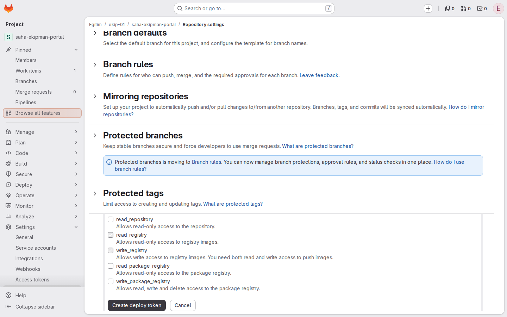
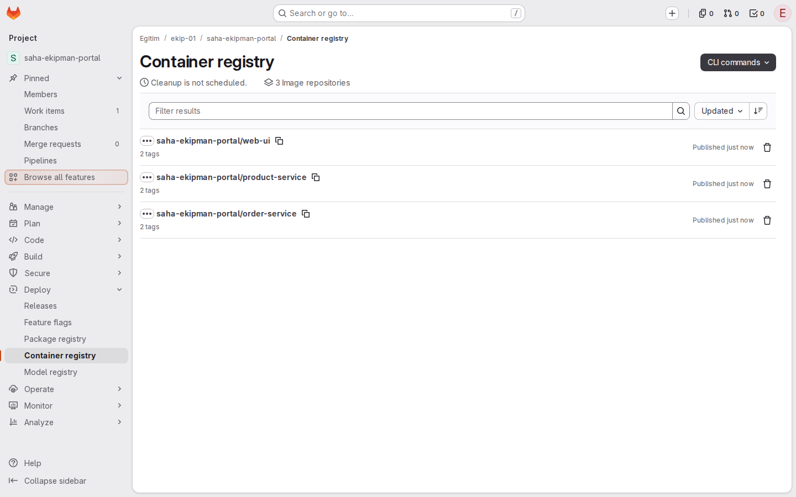
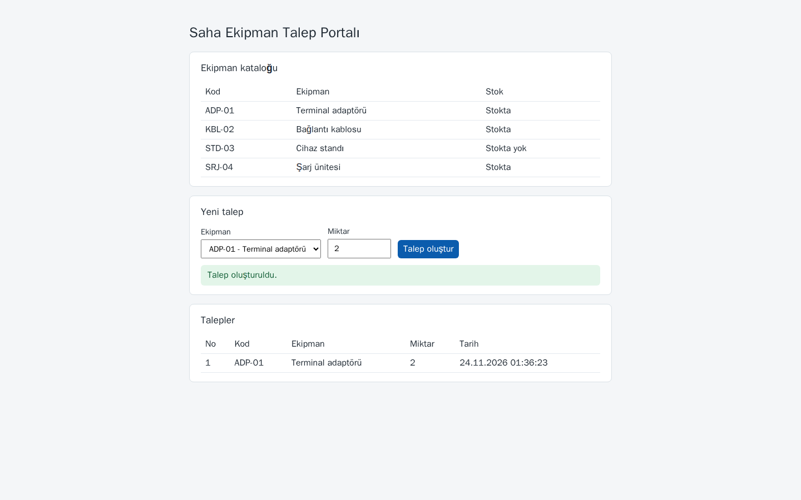
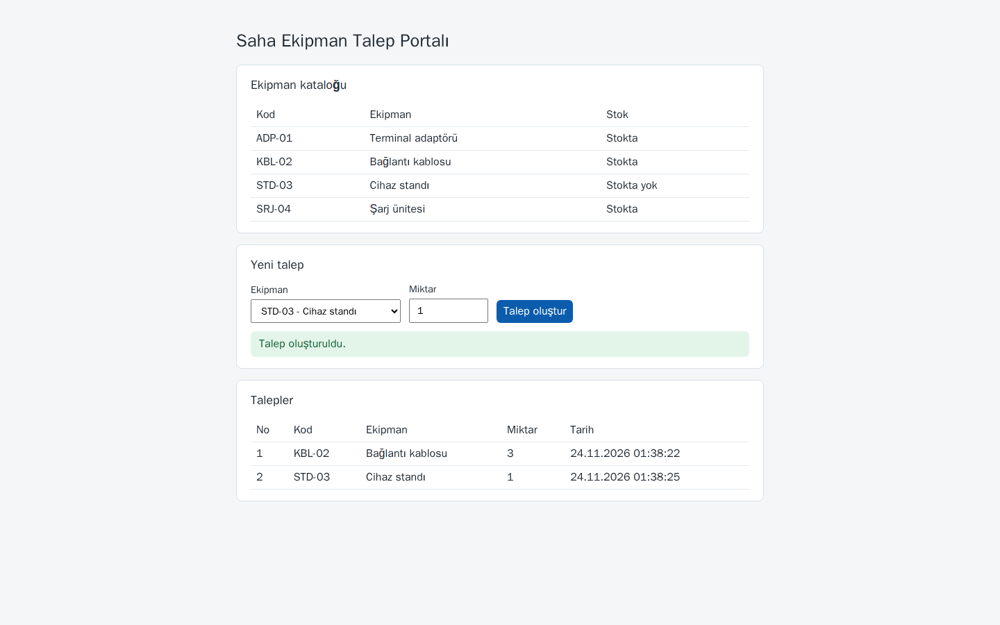

# LAB 03-B · Registry, Compose ve ikinci VM

| | |
|---|---|
| **Gün / modül** | Gün 3 · Modül 4 |
| **Süre** | 95 dk (son 10 dk toparlama ve kontrol) |
| **Başlangıç durumu** | `checkpoint/lab-03a`: `feature/9-docker` branch'inde üç Dockerfile, `.dockerignore`; imajlar lokalde build oluyor |
| **Takılırsan** | `x509`: `certs.d` dizin adına bak. Yetki hatası: token scope'una bak. Eğitmen ekibinizi `checkpoint/lab-03b` durumuna getirebilir (bkz. bölüm 9) |

**Öğrenme kazanımı:** İmajları SemVer ve commit SHA ile etiketleyip iç registry'ye gönderebilir, Docker'a kurum CA'sını doğru yoldan tanıtabilir, üç servisi Compose ile birlikte çalıştırabilir ve aynı imajları kaynak kodun bulunmadığı ikinci bir makinede ayağa kaldırabilirsiniz.

Örnek değerler (prova ortamı, ekip-01):

| Değişken | Örnek değer |
|---|---|
| `REGISTRY` | `gitlab.kurum.test:5050` |
| `IMG` | `gitlab.kurum.test:5050/egitim/ekip-01/saha-ekipman-portal` |
| `CA_CERT` | `/etc/lab/kurum-ca.crt` |
| `TEST_VM`, `TEST_VM_USER` | `test-vm.kurum.test`, `deploy` |
| `WEB_PORT` | `8081` (ekip-01; ekip-02 için `8082` …) |
| `TEST_URL` | `http://test-vm.kurum.test:8081` |
| Test VM dizini | `/opt/saha/ekip01` |
| Compose proje adı | `ekip01` |

## 1. Amaç

"Bir kez build et, etiketle, registry'ye gönder ve başka bir makinede aynen çalıştır." Gün sonunda uygulamanız ikinci VM'de, registry'den çekilen imajlarla çalışacak ve talep kayıtları container yeniden yaratılınca kaybolmayacak.

## 2. Ön koşullar

- LAB 03-A tamam: `feature/9-docker` branch'indesiniz, `git status` temiz, üç imaj build oluyor.
- `echo $IMG $WEB_PORT $TEST_URL` üç değer yazıyor.
- İkinci VM'e SSH ile girebiliyorsunuz: `ssh $TEST_VM_USER@$TEST_VM hostname`.
- Lider (`ekipNN-lead`) GitLab'e giriş yapabiliyor: deploy token'ları o oluşturacak.

## 3. Kullanılacak sistemler

| Sistem | Ne için |
|---|---|
| Eğitim makinesi (Docker, terminal) | Etiketleme, push, lokal Compose |
| İç GitLab | Deploy token, Container Registry sayfası, Merge Request |
| İkinci VM / test VM | Yalnızca Docker ve `compose.yaml`; kaynak kod yok. VM bütün ekiplerce paylaşılır |

## 4. Adımlar

### Adım 1 · Üç imajı `1.0.1` ve commit SHA ile etiketle (10 dk)

Her imaj iki etiket alır: insanın okuduğu sürüm ve değişmeyen commit kimliği.

```bash
cd ~/saha-ekipman-portal
echo $IMG
SHA=$(git rev-parse --short HEAD)
docker build -f src/order-service/Dockerfile   --build-arg MCR=$MCR -t $IMG/order-service:1.0.1   -t $IMG/order-service:$SHA .
docker build -f src/product-service/Dockerfile --build-arg MCR=$MCR -t $IMG/product-service:1.0.1 -t $IMG/product-service:$SHA .
docker build -f src/web-ui/Dockerfile          --build-arg HUB=$HUB -t $IMG/web-ui:1.0.1          -t $IMG/web-ui:$SHA .
docker images | grep "/ekip-$EKIP/"
```

Aynı imajın iki etiketi aynı `IMAGE ID` değerini gösterir: tek imaj, iki isim.

### Adım 2 · Deploy token ile login ol, imajları push et (20 dk)

**2a. Deploy token (lider).** Proje > **Settings > Repository > Deploy tokens** > **Add token**:

- **Name** ve **Username:** `ekipNN-deploy`
- **Scopes:** `read_registry` ve `write_registry`



**Create deploy token**'dan sonra token değeri **yalnızca bir kez** gösterilir. Kopyalayın; bir dosyaya, sohbete ya da repoya yazmayın.

**2b. Login.** Token'ı komut satırına yazmayın; kabuk geçmişine düşer.

```bash
read -rs TOKEN        # token'ı yapıştırın, Enter (ekranda görünmez)
echo "$TOKEN" | docker login $REGISTRY -u ekip$EKIP-deploy --password-stdin
```

Hata alacaksınız. Mesajı okuyun: sorun token'da değil. Kim, kime güvenmiyor?

**2c. Kurum CA'sını Docker'a tanıtın.** Güvenmesi gereken taraf Docker daemon'ıdır. Dizin adı registry adresiyle, **port dahil** birebir aynı olmalıdır; daemon'ı yeniden başlatmak gerekmez.

```bash
sudo mkdir -p /etc/docker/certs.d/$REGISTRY
sudo cp $CA_CERT /etc/docker/certs.d/$REGISTRY/ca.crt
ls -l /etc/docker/certs.d/
```

> `daemon.json` içine `insecure-registries` yazmak doğrulamayı kapatır; kabul edilmez.

**2d. Yeniden login ve push.**

```bash
echo "$TOKEN" | docker login $REGISTRY -u ekip$EKIP-deploy --password-stdin
unset TOKEN
docker push --all-tags $IMG/order-service
docker push --all-tags $IMG/product-service
docker push --all-tags $IMG/web-ui
```

Push çıktısında iki etiketin `digest` değerlerini karşılaştırın.

### Adım 3 · GitLab'de Container Registry sayfasını doğrula (5 dk)

Proje > **Deploy > Container Registry**: üç imaj görünmeli. Birine tıklayın: `1.0.1` ve commit SHA etiketleri aynı digest'i göstermeli.



> **Ara kontrol (45. dakika):** herkesin imajları registry'de olmalı.

### Adım 4 · `compose.yaml` ve `nginx.conf` dosyalarını tamamla (15 dk)

**`deploy/compose.yaml`** (slayt "compose.yaml"). Üç servis, bir volume. Kurallar:

| Konu | Kural |
|---|---|
| İmaj adları | `${IMG}/<servis>:${TAG}`; dosyada sabit adres ya da sürüm yok |
| Port | Yalnızca `web-ui` yayınlar: `"${WEB_PORT:-8080}:8080"` |
| Veri | `orders-data` adlı volume, `order-service` içinde `/data` |
| Bağlantı ayarı | `order-service` için ortam değişkeni `ConnectionStrings__Orders` = `Data Source=/data/orders.db` |
| Sıra | `web-ui`, iki API'den sonra başlar (`depends_on`) |

İskelet:

```yaml
services:
  product-service:
    image: # ...
  order-service:
    image: # ...
    environment:
      # ...
    volumes:
      # ...
  web-ui:
    image: # ...
    ports: # ...
    depends_on: # ...
volumes:
  # ...
```

Yazdıklarınızı çözülmüş haliyle görün:

```bash
TAG=1.0.1 docker compose -p ekip$EKIP -f deploy/compose.yaml config
```

**`deploy/nginx.conf`**: LAB 03-A'da yazdığınız `server` bloğuna iki `location` ekleyin. `/api/products` istekleri `product-service`'e, `/api/orders` istekleri `order-service`'e gitsin (`proxy_pass`). Hedef adresteki ad Compose **servis adıdır**, port 8080'dir; adresin sonuna yol yazmayın ki istek yolu aynen iletilsin.

```bash
git add deploy
git commit -m "feat(deploy): add compose file and nginx reverse proxy"
```

`nginx.conf` imajın **içindedir**: `web-ui` imajını yeniden build edin.

```bash
SHA=$(git rev-parse --short HEAD)
docker build -f src/web-ui/Dockerfile --build-arg HUB=$HUB -t $IMG/web-ui:1.0.1 -t $IMG/web-ui:$SHA .
```

### Adım 5 · Lokalde `compose up`; arayüzden bir talep oluştur (15 dk)

```bash
export TAG=1.0.1
docker compose -p ekip$EKIP -f deploy/compose.yaml up -d
docker compose -p ekip$EKIP -f deploy/compose.yaml ps -a
```

Tarayıcıda `http://localhost:$WEB_PORT` adresini açın (`echo $WEB_PORT`).

Bir şey çalışmayacak. Bu labın beklenen hatasıdır; çözümü siz bulacaksınız. Sırayla:

```bash
docker compose -p ekip$EKIP -f deploy/compose.yaml logs order-service
docker compose -p ekip$EKIP -f deploy/compose.yaml logs web-ui
```

Bölüm 7'deki ilk satır sizi yönlendirir. Düzeltmeyi yaptıktan sonra:

1. Değişikliği commit edin.
2. Kod değiştiği için **üç imajı** Adım 1'deki komutlarla yeniden etiketleyin (`SHA` yeni commit'i göstersin).
3. Compose'u yeniden başlatın ve arayüzden bir talep oluşturun.



**Kalıcılığı sınayın:** container'ları silip yeniden yaratın; talep yerinde durmalı.

```bash
curl -fsS --retry 10 --retry-connrefused --retry-delay 2 http://localhost:$WEB_PORT/api/orders; echo
docker compose -p ekip$EKIP -f deploy/compose.yaml down
docker compose -p ekip$EKIP -f deploy/compose.yaml up -d
curl -fsS --retry 10 --retry-connrefused --retry-delay 2 http://localhost:$WEB_PORT/api/orders; echo
docker compose -p ekip$EKIP -f deploy/compose.yaml down
```

Son olarak branch'i ve **yeni imajları** gönderin:

```bash
git push
docker push --all-tags $IMG/order-service
docker push --all-tags $IMG/product-service
docker push --all-tags $IMG/web-ui
```

> **`1.0.1` etiketinin üzerine yazdınız.** Push çıktısına bakın: `1.0.1` artık yeni digest'i gösteriyor, eski commit SHA etiketi ise eski imajı. Eğitimde bunu yapabildik çünkü `1.0.1` henüz hiçbir ortama dağıtılmamıştı. Yayınlanmış bir SemVer etiketinin üzerine yazılmaz; yeni PATCH sürümü çıkarılır.

### Adım 6 · İkinci VM'de pull et, kendi proje adınla çalıştır (10 dk)

İkinci VM'de kaynak kod yok; yalnızca `compose.yaml` ve değişkenler var. Eğitim makinenizden gönderin:

```bash
scp deploy/compose.yaml $TEST_VM_USER@$TEST_VM:/opt/saha/ekip$EKIP/compose.yaml
printf 'IMG=%s\nTAG=1.0.1\nWEB_PORT=%s\n' "$IMG" "$WEB_PORT" | ssh $TEST_VM_USER@$TEST_VM "cat > /opt/saha/ekip$EKIP/.env"
```

**VM paylaşılıyor:** her ekip registry girişini kendi dizininde tutar (`DOCKER_CONFIG`), yoksa bir ekibin girişi diğerininkinin üzerine yazar. Komutları eğitim makinenizden, `ssh` üzerinden çalıştıracaksınız; 5. gün Jenkins de tam olarak bunu yapacak. Tekrarı azaltmak için küçük bir yardımcı tanımlayın:

```bash
VM=$TEST_VM_USER@$TEST_VM
vm() { ssh $VM "cd /opt/saha/ekip$EKIP && export DOCKER_CONFIG=/opt/saha/ekip$EKIP/.docker && $*"; }

vm "ls -a && cat .env"
vm docker compose -p ekip$EKIP pull
```

Pull reddedilecek: bu makinede giriş yapmadınız.

**Lider:** ikinci bir deploy token oluşturun: ad ve kullanıcı adı `ekipNN-pull`, scope **yalnızca** `read_registry`. Test VM'in imaj göndermeye ihtiyacı yok.

```bash
read -rs TOKEN
echo "$TOKEN" | ssh $VM "mkdir -p /opt/saha/ekip$EKIP/.docker && DOCKER_CONFIG=/opt/saha/ekip$EKIP/.docker docker login $REGISTRY -u ekip$EKIP-pull --password-stdin"
unset TOKEN

vm docker compose -p ekip$EKIP pull
vm docker compose -p ekip$EKIP up -d
vm docker compose -p ekip$EKIP ps
```

> VM'e `ssh $VM` ile girip aynı komutları elle de çalıştırabilirsiniz; o zaman önce `cd /opt/saha/ekipNN` ve `export DOCKER_CONFIG=$PWD/.docker` yazmayı unutmayın.

### Adım 7 · `curl` ile smoke test; MR ile `develop`'a gönder (10 dk)

Eğitim makinenizden:

```bash
curl -fsS --retry 10 --retry-connrefused --retry-delay 2 $TEST_URL/api/products | head -c 60; echo
curl -fsS -o /dev/null -w '%{http_code}\n' -X POST $TEST_URL/api/orders \
  -H 'Content-Type: application/json' -d '{ "productId": "KBL-02", "quantity": 3 }'
curl -fsS $TEST_URL/api/orders; echo
```

`curl -f` HTTP hata kodunda sıfır dışı çıkış verir; 5. gün pipeline'ın smoke test adımı tam olarak budur. Tarayıcıda `$TEST_URL` adresini de açın.



**MR:** `feature/9-docker` → `develop`. Başlık örneği `build(docker): add Dockerfiles and compose deployment`; açıklamada LAB 03-A'da açtığınız issue: `Closes #3`. Feature MR'ı: squash açık, kaynak branch silinsin. Lider inceleyip merge etsin.

```bash
git switch develop && git pull
git fetch --prune
git branch -D feature/9-docker
```

### Toparlama (10 dk)

Bölüm 6'yı işaretleyin; bölüm 8'i yanıtlayın. Gün sonunda eğitmen isterse ikinci VM'deki uygulamayı kapatın (`vm docker compose -p ekip$EKIP down`; `-v` **eklemeyin**, veri kalsın).

## 5. Beklenen çıktı

Adım 2b, CA tanıtılmadan önce:

```
Error response from daemon: Get "https://gitlab.kurum.test:5050/v2/": tls: failed to verify certificate: x509: certificate signed by unknown authority
```

Adım 2d:

```
Login Succeeded
$ docker push --all-tags $IMG/order-service
1.0.1: digest: sha256:cc6f68d6220e… size: 856
afd5969: digest: sha256:cc6f68d6220e… size: 856
```

Adım 5'in sonundaki push (örnek; digest'ler sizde farklıdır):

```
1.0.1: digest: sha256:ed8f9301de52… size: 856      <- yeni imaj
afd5969: digest: sha256:cc6f68d6220e… size: 856    <- ilk build
d99149c: digest: sha256:ed8f9301de52… size: 856    <- son commit
```

Adım 6, login'den önce:

```
Error response from daemon: error from registry: access forbidden
```

Adım 6, `docker compose -p ekip01 ps` (kısaltılmış):

```
NAME                       IMAGE                                        STATUS         PORTS
ekip01-order-service-1     …/ekip-01/saha-ekipman-portal/order-service:1.0.1     Up 2 seconds   8080/tcp
ekip01-product-service-1   …/ekip-01/saha-ekipman-portal/product-service:1.0.1   Up 2 seconds   8080/tcp
ekip01-web-ui-1            …/ekip-01/saha-ekipman-portal/web-ui:1.0.1            Up 1 second    0.0.0.0:8081->8080/tcp
```

Adım 7:

```
[{"code":"ADP-01","name":"Terminal adaptörü","inStock":tru
201
[{"id":1,"productId":"KBL-02","quantity":3,"createdAt":"2026-11-23T22:38:22.8790378Z"}]
```

## 6. Başarı kriterleri

- [ ] Registry'de üç imaj var; her birinde `1.0.1` ve bir commit SHA etiketi aynı digest'i gösteriyor.
- [ ] Docker'a kurum CA'sı `certs.d` ile tanıtıldı; `insecure-registries` kullanılmadı.
- [ ] `compose.yaml` içinde sabit adres, sürüm ya da `latest` yok; yalnızca `web-ui` port yayınlıyor.
- [ ] Uygulama ikinci VM'de registry'den çekilen `1.0.1` imajlarıyla, `ekipNN` proje adıyla çalışıyor.
- [ ] `curl -fsS --retry 10 --retry-connrefused --retry-delay 2 $TEST_URL/api/products` ekipmanları döndürüyor.
- [ ] Talep kaydı, container'lar silinip yeniden yaratılınca kaybolmuyor.
- [ ] Değişiklikler MR ile `develop`'a merge edildi.

## 7. Yaygın hatalar ve ipuçları

| Belirti | Olası neden | Ne yapmalı |
|---|---|---|
| Lokalde `compose up` sonrası arayüz "Veriler yüklenemedi" diyor; `order-service` logunda `SQLite Error 14: 'unable to open database file'` | Uygulama root olmayan kullanıcıyla çalışıyor ve veritabanı dosyasını oluşturacağı dizine yazamıyor | Üç soru: Süreç hangi kullanıcıyla çalışıyor (`docker exec … id`)? `/data` dizininin sahibi kim (`docker exec … ls -ld /data`)? O dizini imajda kim, ne zaman oluşturmalı? Slayt "Güvenli ve küçük imaj: üç alışkanlık", ilk kart. Düzeltme `order-service` Dockerfile'ında tek satırdır |
| Düzeltmeyi yaptım, imajı yeniden build ettim, hata sürüyor | Volume ilk bağlandığında oluşan sahiplik duruyor; eski volume hâlâ root'a ait | Volume'u silip yeniden oluşturun: `docker compose … down -v`, sonra `up -d`. (Yalnızca henüz veri yokken!) |
| `docker compose ps` her şeyi "Up" gösteriyor ama talepler çalışmıyor | Container'ın "çalışıyor" olması "sağlıklı" olduğunu göstermez | Önce `logs`, sonra `ps`; hata çoğu zaman logun ilk satırlarındadır |
| `x509: certificate signed by unknown authority` (login, push ya da pull) | Docker daemon'ı kurum CA'sına güvenmiyor | Adım 2c. `ls /etc/docker/certs.d/` çıktısındaki dizin adı `$REGISTRY` ile port dahil aynı mı? |
| `error from registry: access forbidden` | O makinede o registry için giriş yok ya da imaj yolu proje yolunun altında değil | `docker login`; `echo $IMG` proje yolunuzla başlıyor mu? İkinci VM'de `DOCKER_CONFIG` ayarlı mı? |
| Push sırasında `insufficient_scope: authorization failed` | Giriş yapılan token'da `write_registry` yok (örneğin `ekipNN-pull` ile push) | `ekipNN-deploy` ile yeniden login |
| `manifest unknown` / `not found` (pull) | O etiket registry'de yok | `.env` içindeki `TAG` değerine ve Container Registry sayfasına bakın |
| `Bind for 0.0.0.0:8081 failed: port is already allocated` | Aynı portu başka bir proje kullanıyor | `WEB_PORT` ekibinize ait mi? `-p ekipNN` verdiniz mi? Lokalde eski container'ı kapatın: `docker compose … down` |
| `web-ui` açılmıyor; logda `host not found in upstream "order-service"` | `nginx.conf` içindeki ad Compose servis adıyla aynı değil ya da o servis hiç başlamadı | Servis adlarını `compose.yaml` ile karşılaştırın; `docker compose … ps -a` |
| `variable is not set. Defaulting to a blank string` | `IMG` ya da `TAG` tanımsız | Lokalde `export TAG=1.0.1`; VM'de `.env` dosyası `compose.yaml` ile aynı dizinde mi? |
| VM'de bir süre sonra pull yeniden reddediliyor | `DOCKER_CONFIG` ayarlanmadan login yapıldı; başka bir ekip aynı girişin üzerine yazdı | Adım 6'daki `vm` yardımcısını ve login komutunu kullanın |

## 8. Kendini kontrol soruları

1. `latest` etiketiyle deploy edilen bir ortamda rollback neden zordur? Bugün `1.0.1` etiketinin üzerine yazdığınızda neyi kaybettiniz, hangi etiket sizi kurtardı?
2. Root olmayan kullanıcıya geçince volume'a yazma neden bozuldu? Düzeltmeden sonra volume'u neden yeniden oluşturmak gerekti?
3. İkinci VM'de kaynak kod yok ama uygulama çalışıyor. Config (imaj adı, sürüm, port, bağlantı ayarı) nerede duruyor? Aynı `compose.yaml` ile bir önceki sürüme nasıl dönerdiniz?

## 9. Başlangıç durumuna dönme

**Lokalde temizlemek:**

```bash
docker compose -p ekip$EKIP -f deploy/compose.yaml down -v     # lokal deneme verisini de siler
```

**İkinci VM'de kendi uygulamanızı kaldırmak** (yalnızca kendi proje adınız):

```bash
ssh $TEST_VM_USER@$TEST_VM "cd /opt/saha/ekip$EKIP && docker compose -p ekip$EKIP down"     # -v eklerseniz talepler de silinir
```

**Laba baştan başlamak ya da `checkpoint/lab-03b`'ye geçmek:** registry'deki imajlar, deploy token'lar ve test VM ortak durumdur; eğitmen kurar. Ekip numaranızı söyleyin:

- *Baştan (`checkpoint/lab-03a`):* `feature/9-docker` LAB 03-A'nın sonuna döner; test VM'deki uygulamanız ve verisi kaldırılır.
- *`checkpoint/lab-03b`:* `develop` güncellenir, imajlar `1.0.1` etiketiyle registry'ye konur, uygulama ikinci VM'de çalışır halde gelir. Yeni deploy token'larınız `~/.lab/deploy-tokens` dosyasına yazılır. Eski çalışma kopyanız `~/yedek/` altına taşınır.
