# LAB 04-A · GitLab bağlantısı ve ilk pipeline

| | |
|---|---|
| **Gün / modül** | Gün 4 · Modül 3 |
| **Süre** | 90 dk (son 10 dk toparlama ve kontrol) |
| **Başlangıç durumu** | `checkpoint/lab-03b`: `develop` üzerinde Dockerfile'lar ve `deploy/`; `Jenkinsfile` yalnızca açıklama içeren bir iskelet |
| **Takılırsan** | Webhook "URL is blocked" diyorsa eğitmene haber verin: ağ izni yönetici ayarıdır. Eğitmen ekibinizi `checkpoint/lab-04a` durumuna getirebilir (bkz. bölüm 9) |

**Öğrenme kazanımı:** GitLab ile Jenkins'i iki yönde bağlayabilir (push Jenkins'i tetikler, Jenkins sonucu GitLab'e yazar), build ve testleri çalıştıran bir Declarative Pipeline yazabilir ve kırılan bir testin merge'ü engellediğini gösterebilirsiniz.

Örnek değerler (prova ortamı, ekip-01):

| Değişken / ad | Örnek değer |
|---|---|
| `GITLAB_URL` | `https://gitlab.kurum.test` |
| `JENKINS_URL` | `https://jenkins.kurum.test` |
| Jenkins klasörünüz | `ekip-01` (`$JENKINS_URL/job/ekip-01/`) |
| Multibranch job adı | `saha-portal-ekip01` |
| Webhook adresi | `$JENKINS_URL/project/ekip-01/saha-portal-ekip01` |
| Credential ID'leri | `gitlab-api`, `gitlab-repo` |
| GitLab connection adı (Jenkins'te hazır) | `gitlab` |
| Agent label'ı | `dotnet-docker` |

## 1. Amaç

Her push'ta pipeline kendiliğinden başlasın; sonucu Merge Request ekranında görünsün; kırmızı pipeline merge'ü kapatsın. Bugünden sonra `develop`'a giren her değişiklik bu kapıdan geçecek.

## 2. Ön koşullar

- LAB 03-B tamam: `git switch develop && git pull` temiz; `git status` boş.
- Jenkins'e ortam kartındaki hesabınızla (`ekipNN`) girebiliyorsunuz ve `ekip-NN` klasörünü görüyorsunuz.
- Lider (`ekipNN-lead`) GitLab'e giriş yapabiliyor: token, webhook ve merge ayarı Maintainer işidir.
- Repoda `.gitlab-ci.yml` **yok** (`git ls-files | grep gitlab-ci` boş döner). Pipeline'ı Jenkins çalıştırır; ikinci bir CI tanımı aynı commit'e ikinci bir durum yazar.

## 3. Kullanılacak sistemler

| Sistem | Ne için |
|---|---|
| İç GitLab | Project Access Token, webhook, merge ayarı, Merge Request |
| Jenkins (ortak; klasörünüz `ekip-NN`) | Credential'lar, Multibranch Pipeline job'ı, build ve test sonuçları |
| Eğitim makinesi (terminal) | `Jenkinsfile`, commit, push |

Jenkins ortaktır: **GitLab connection (`gitlab`) ve agent yönetici tarafından kurulmuştur**; siz yalnızca kendi klasörünüzde çalışırsınız. Başka ekibin klasörünü göremezsiniz.

## 4. Adımlar

### Adım 1 · GitLab'de `api` scope'lu Project Access Token üret (5 dk)

**Lider.** Proje > **Settings > Access tokens** > **Add new token**:

- **Token name:** `jenkins`
- **Select a role:** `Maintainer`
- **Scopes:** yalnızca `api`

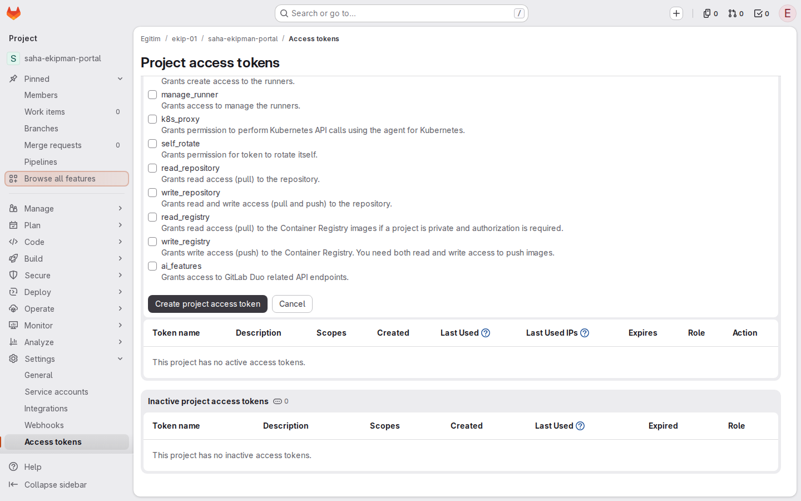

**Create project access token**'dan sonra değer **yalnızca bir kez** gösterilir. Kopyalayın; bir sonraki adımda Jenkins'e yapıştıracaksınız. Dosyaya, sohbete ya da repoya yazmayın.

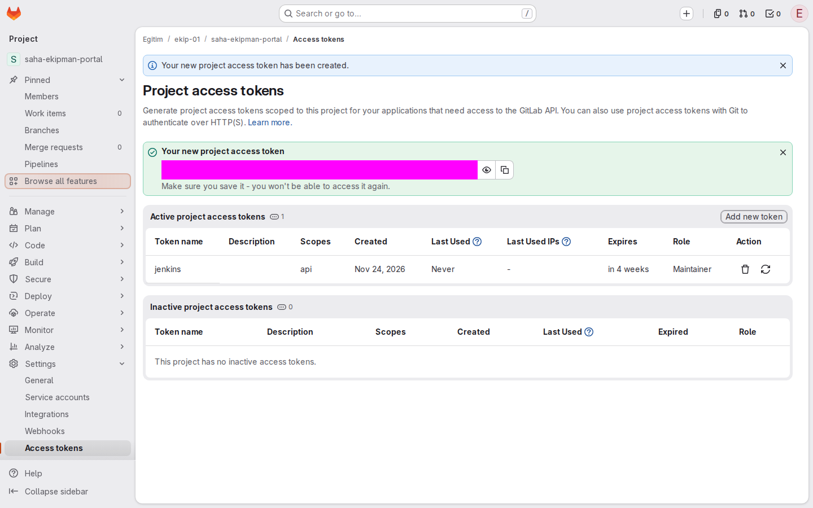

> Bu token bir kişiye değil **projeye** aittir: ekipten biri ayrılsa da pipeline çalışır; yetkisi tek bu projeyle sınırlıdır.

### Adım 2 · Jenkins'te credential'ları ve Multibranch job'ı oluştur (15 dk)

**2a. İki credential.** Jenkins'te klasörünüzü açın (`$JENKINS_URL/job/ekip-NN/`) > **Credentials** > **Folder** satırındaki **Global** > **Add Credentials**.

Aynı token'ı **iki ayrı türde** kaydedeceksiniz, çünkü onu iki ayrı plugin kullanır:

| ID | Tür | Alanlar | Kim kullanır? |
|---|---|---|---|
| `gitlab-api` | **GitLab API token** | API token: *token* | GitLab plugin: sonucu GitLab'e yazar |
| `gitlab-repo` | **Username with password** | Username: `jenkins`, Password: *token* | Git plugin: repoyu okur (HTTPS) |

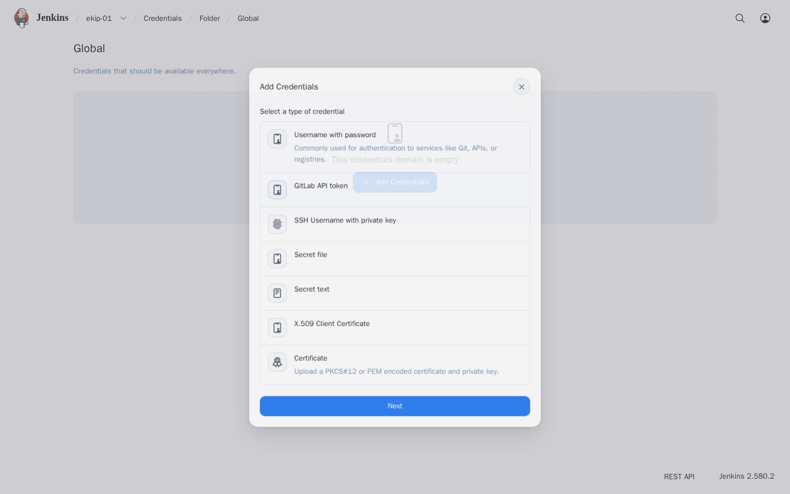

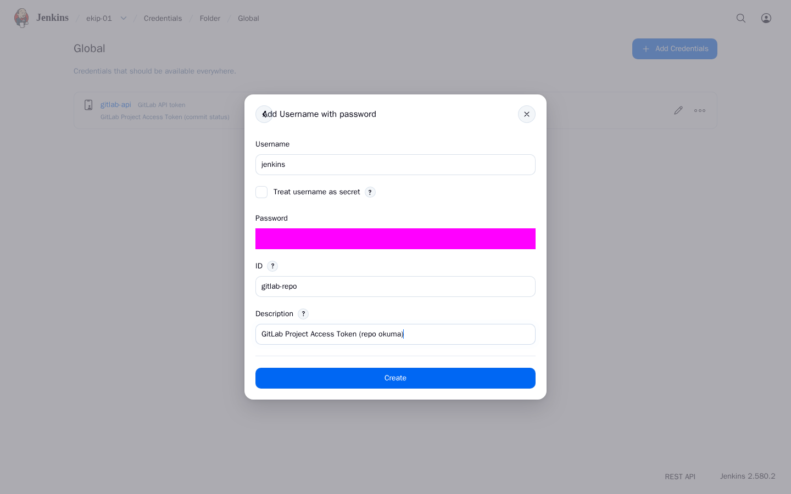

ID'leri **tam olarak** böyle yazın; `Jenkinsfile` onları bu adlarla arayacak. ID sonradan değiştirilemez.

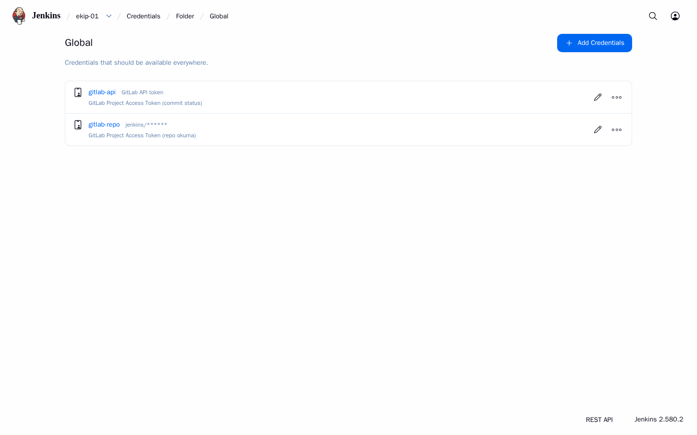

> Credential'ı klasöre eklediniz, Jenkins'in geneline değil: yalnızca `ekip-NN` altındaki job'lar kullanabilir. Değerini Jenkins bir daha göstermez.

**2b. Multibranch Pipeline.** Klasörünüzde **New Item**:

- **Name:** `saha-portal-ekipNN`
- Tür: **Multibranch Pipeline** > **OK**

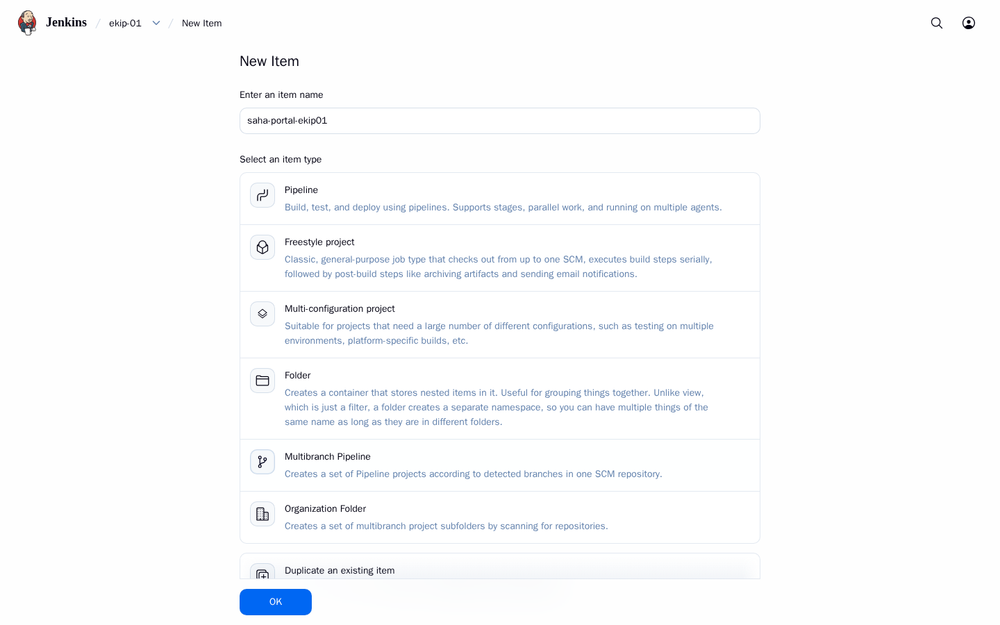

Açılan sayfada **Branch Sources > Add source > Git**:

- **Project Repository:** projenizin **HTTPS** adresi (GitLab'de **Code > Clone with HTTPS**)
- **Credentials:** `gitlab-repo`

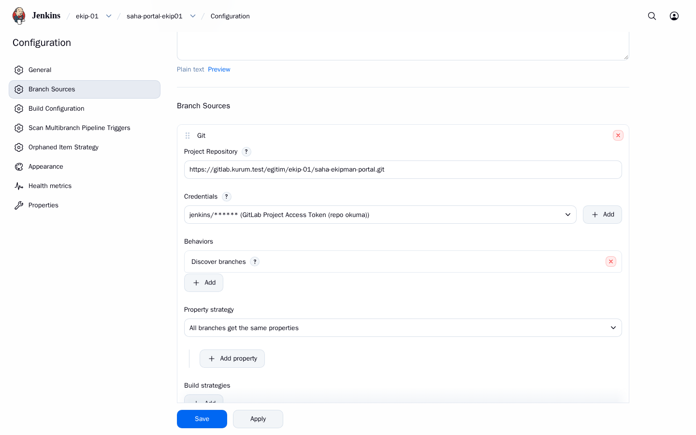

**Save**. Jenkins repoyu tarar ("Scan Multibranch Pipeline Log") ve `Jenkinsfile` bulunan her branch için bir job açar.

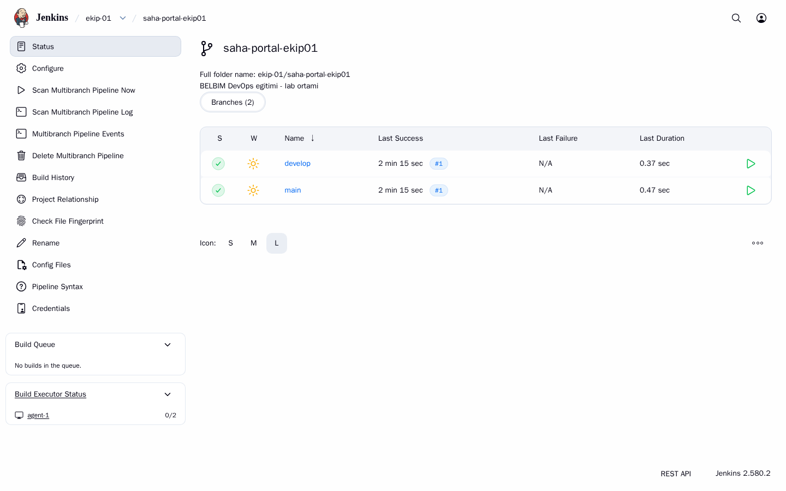

`develop` ve `main` göründü ve yeşil: iskelet `Jenkinsfile` içinde henüz hiçbir stage yok, build "hiçbir şey yapmadan" bitti. Adım 4'te dolduracaksınız.

### Adım 3 · Webhook ekle; "Test > Push events" ile sına (10 dk)

**Lider.** Proje > **Settings > Webhooks** > **Add new webhook**:

- **URL:** `$JENKINS_URL/project/ekip-NN/saha-portal-ekipNN` (klasör **ve** job adı; `echo $JENKINS_URL/project/ekip-$EKIP/saha-portal-ekip$EKIP`)
- **Trigger:** yalnızca **Push events**
- **SSL verification:** açık kalsın

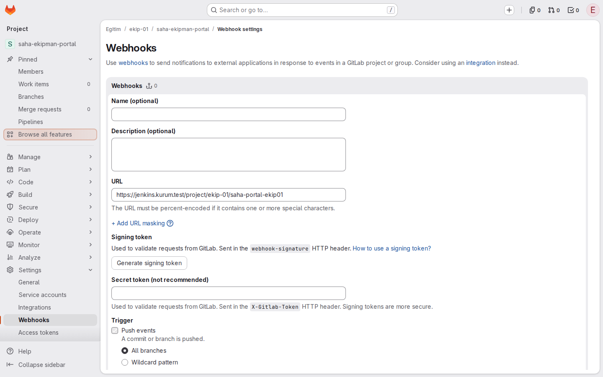

**Add webhook**, ardından satırdaki **Test > Push events**:

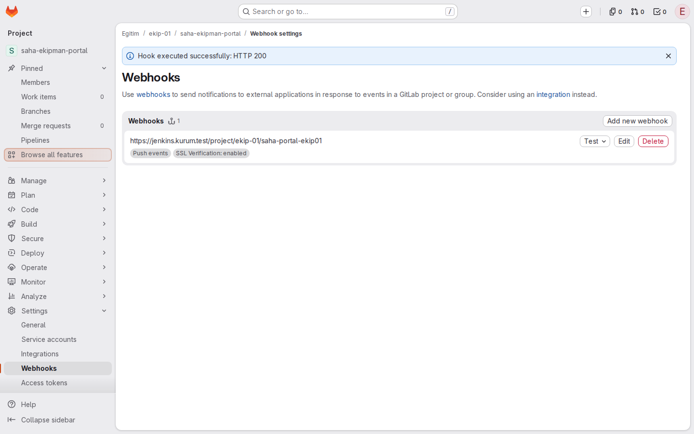

`Hook executed successfully: HTTP 200` birinci okun tamam olduğunu gösterir: GitLab, Jenkins'e ulaşabiliyor.

> **Neden yalnızca Push events?** Multibranch job branch'leri izler: her push'ta repoyu yeniden tarar ve değişen branch'i derler. "Merge request events" işaretlenirse Jenkins o istekleri `409` ile geri çevirir. MR ekranındaki durum, MR'ın son commit'ine yazılan sonuçtan gelir; ayrı bir MR olayına gerek yoktur.

> **Ara kontrol (35. dakika):** herkesin webhook testi `HTTP 200` dönmeli.

### Adım 4 · `Jenkinsfile`: Restore, Build, Unit Test, web-ui (20 dk)

GitLab'de bir issue açın: `Her push'ta build ve test: Jenkins pipeline` (numarasını not edin).

```bash
cd ~/saha-ekipman-portal
git switch develop && git pull
git switch -c feature/pipeline
```

Kökteki `Jenkinsfile` dosyasını doldurun (slayt "Declarative Jenkinsfile iskeleti", ".NET stage'leri", "React stage'i"). İskelet:

```groovy
pipeline {
  agent { label '...' }                       // ortam kartındaki agent label'ı

  options {
    gitLabConnection(gitLabConnection: 'gitlab', jobCredentialId: 'gitlab-api', useAlternativeCredential: true)
    gitlabBuilds(builds: ['jenkins'])
    timeout(time: 30, unit: 'MINUTES')
  }

  environment {
    REGISTRY = '...'                          // echo $REGISTRY
    IMG      = "${REGISTRY}/..."              // echo $IMG ile karşılaştırın
  }

  stages {
    stage('Restore')   { steps { /* ... */ } }
    stage('Build')     { steps { /* ... */ } }
    stage('Unit Test') {
      steps { /* ... */ }
      post { always { junit '...' } }
    }
    stage('web-ui') {
      steps { dir('src/web-ui') { /* ... */ } }
      post { always { junit '...' } }
    }
  }

  post {
    success { updateGitlabCommitStatus name: 'jenkins', state: 'success' }
    failure { /* ... */ }
    aborted { /* ... */ }
  }
}
```

`options` bloğunu olduğu gibi yazın:

| Satır | Anlamı |
|---|---|
| `gitLabConnection(...)` | `gitlab`: yöneticinin kurduğu bağlantının adı. `jobCredentialId: 'gitlab-api'`: sonuç GitLab'e **sizin** token'ınızla yazılır (bağlantı ortak, token ekibe özel) |
| `gitlabBuilds(builds: ['jenkins'])` | Build başlar başlamaz GitLab'deki durum `pending` olur: MR "çalışıyor" görünür |
| `timeout` | Takılan build executor'ı saatlerce tutmasın |

Stage ipuçları:

| Stage | Komut(lar) | Dikkat |
|---|---|---|
| Restore | `dotnet restore SahaPortal.sln` | |
| Build | `dotnet build`, `Release` yapılandırması | Restore'u yinelemesin: `--no-restore` |
| Unit Test | `dotnet test`, `Release` | Yeniden derlemesin: `--no-build`. Jenkins'in okuyacağı rapor için `--logger "junit;LogFileName=junit.xml"`; `junit` adımına desen: `**/TestResults/junit.xml` |
| web-ui | `npm ci`, `npm test -- --coverage --ci`, `npm run build` | Rapor: `src/web-ui/junit.xml` |

`post` bloğunda üç sonuç için de **aynı ad** (`jenkins`) kullanılır: `success`, `failed`, `canceled`. Aynı commit'e iki farklı adla durum yazılırsa GitLab ikisini de bekler.

```bash
git add Jenkinsfile
git commit -m "ci: add Jenkins pipeline"
git push -u origin feature/pipeline
```

Jenkins'te job'ınıza bakın: `feature/pipeline` branch'i birkaç saniye içinde belirir ve build başlar. Build'e tıklayın: **Console Output**, **Tests**.

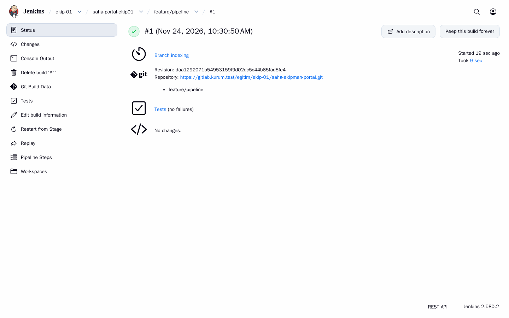

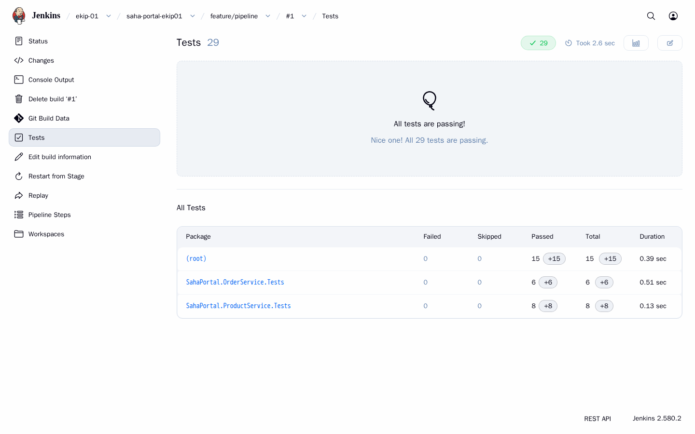

Build sayfasındaki **Revision** değerini `git rev-parse HEAD` çıktınızla karşılaştırın: Jenkins sizin commit'inizi derledi.

### Adım 5 · MR aç; pipeline durumunu MR ekranında gör (10 dk)

**Geliştirici.** `feature/pipeline` → `develop`. Başlık: `ci: add Jenkins pipeline`; açıklamaya `Closes #<issue numaranız>`. Feature MR'ı: squash açık, kaynak branch silinsin.

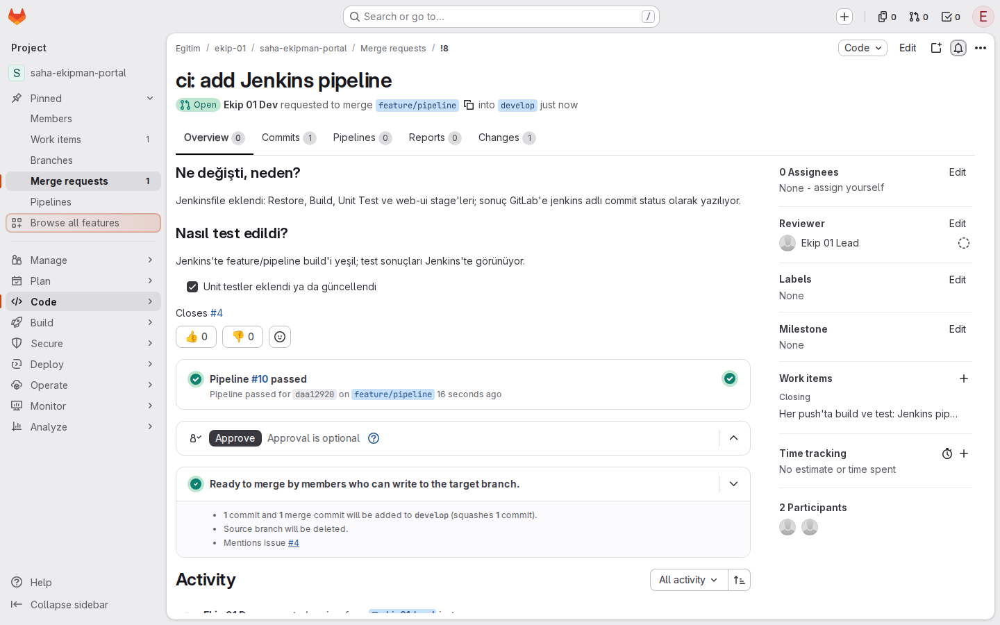

"Pipeline #… passed" satırı Jenkins'in yazdığı durumdur. Numarasına tıklayın: açılan sayfadaki `jenkins` adlı iş, Jenkins'teki build'e bağlanır. İkinci ok da tamam.

### Adım 6 · "Pipelines must succeed" ayarını aç, bir testi boz (10 dk)

**Lider.** Proje > **Settings > Merge requests > Merge checks** > **Pipelines must succeed** > **Save changes**.

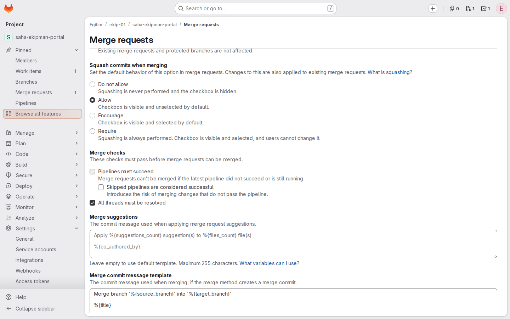

**Geliştirici.** Bir testi bilerek bozun: `tests/order-service.tests/OrdersApiTests.cs` içinde boş ekipman kodu için beklenen `HttpStatusCode.BadRequest` değerini `HttpStatusCode.OK` yapın.

```bash
dotnet test tests/order-service.tests        # lokalde de kırmızı olmalı
git commit -am "test(order): expect 200 for an empty product id"
git push
```

### Adım 7 · Merge'ün engellendiğini gör; düzelt ve merge et (10 dk)

MR sayfasını yenileyin:

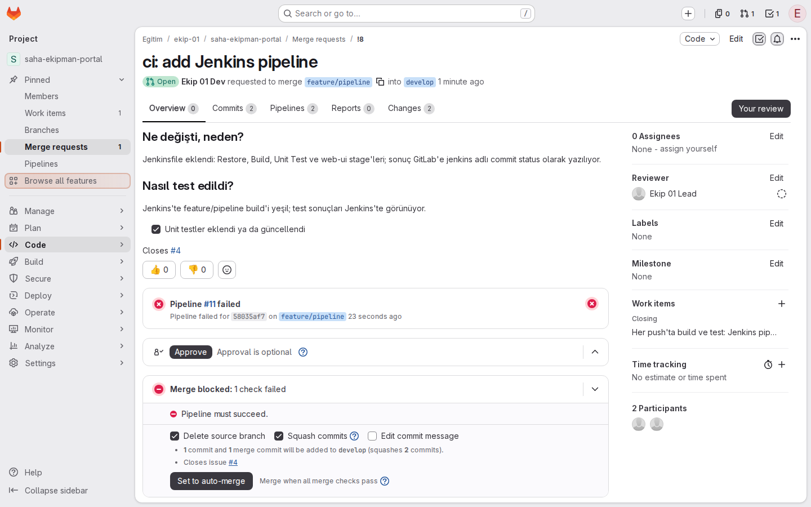

Lider de merge edemez: "Merge" düğmesi yoktur. Hangi testin kırıldığını Jenkins'te okuyun (build > **Tests**):

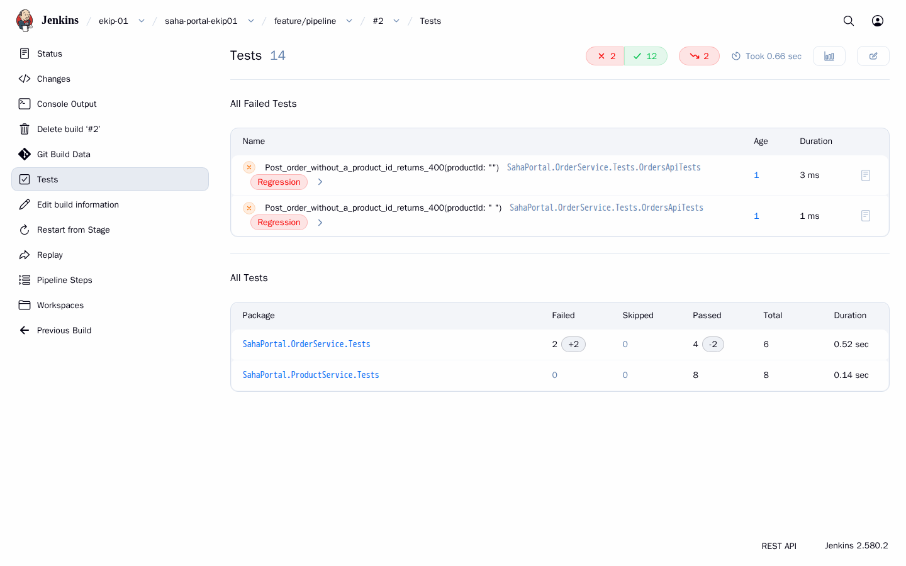

Düzeltin: bozan commit'i geri alın.

```bash
git revert --no-edit HEAD
dotnet test tests/order-service.tests
git push
```

Push'tan hemen sonra MR'a bakın: pipeline çalışırken de merge kapalıdır ("Set to auto-merge" görünür; isterseniz kullanın: pipeline yeşil olunca kendiliğinden merge eder). Yeşil olunca **lider** merge etsin.

```bash
git switch develop && git pull
git fetch --prune
git branch -D feature/pipeline
```

Merge de bir push'tur: Jenkins'te `develop` build'inin başladığını ve yeşil bittiğini görün.

### Toparlama (10 dk)

Bölüm 6'yı işaretleyin; bölüm 8'i yanıtlayın. Token değerini bir yere not ettiyseniz silin: Jenkins'te duruyor, başka yerde gerekmez.

## 5. Beklenen çıktı

Adım 2b, tarama logu (kısaltılmış):

```
Checking branches...
  Checking branch develop
      ‘Jenkinsfile’ found
    Met criteria
Scheduled build for branch: develop
  Checking branch main
      ‘Jenkinsfile’ found
    Met criteria
Scheduled build for branch: main
Finished: SUCCESS
```

Adım 4, Console Output (kısaltılmış):

```
Checking out Revision daa1292071b54953159f9d02dc5c44b65fad5fe4 (feature/pipeline)
[Pipeline] { (Restore)
[Pipeline] { (Build)
[Pipeline] { (Unit Test)
Passed!  - Failed:     0, Passed:     8, Skipped:     0, Total:     8 - product-service.tests.dll (net10.0)
Passed!  - Failed:     0, Passed:     6, Skipped:     0, Total:     6 - order-service.tests.dll (net10.0)
[Pipeline] { (web-ui)
Finished: SUCCESS
```

Adım 6, lokalde ve Jenkins'te:

```
  Failed SahaPortal.OrderService.Tests.OrdersApiTests.Post_order_without_a_product_id_returns_400(productId: "")
Failed!  - Failed:     2, Passed:     4, Skipped:     0, Total:     6 - order-service.tests.dll (net10.0)
ERROR: script returned exit code 1
Finished: FAILURE
```

Adım 7, MR ekranı: `Pipeline #… failed`, `Merge blocked: 1 check failed`, `Pipeline must succeed.`

## 6. Başarı kriterleri

- [ ] Webhook testi `HTTP 200` döndü; her push'tan sonra Jenkins'te ilgili branch'in build'i kendiliğinden başlıyor.
- [ ] Jenkins, push ettiğiniz commit'i derliyor (build sayfasındaki Revision = `git rev-parse HEAD`).
- [ ] Test sonuçları Jenkins'te (**Tests**), pipeline durumu GitLab MR ekranında görünüyor.
- [ ] Aynı commit için GitLab'de tek bir durum adı var: `jenkins`. Repoda `.gitlab-ci.yml` yok.
- [ ] Test kırıkken MR merge edilemedi; düzeltmeden sonra merge edildi.
- [ ] `develop` build'i yeşil.
- [ ] Token değeri repoda, `Jenkinsfile` içinde ya da bir dosyada yok.

## 7. Yaygın hatalar ve ipuçları

| Belirti | Olası neden | Ne yapmalı |
|---|---|---|
| Webhook eklenirken ya da testte `URL is blocked: Requests to the local network are not allowed` | GitLab'in giden istek izin listesinde Jenkins yok | Yönetici ayarıdır; eğitmene haber verin |
| Webhook testi `HTTP 404` | Adresteki klasör ya da job adı yanlış | Adres `…/project/ekip-NN/saha-portal-ekipNN` biçiminde; Jenkins'teki adlarla harf harf karşılaştırın |
| Webhook testi `HTTP 409` (Merge request events) | Multibranch job MR olayını desteklemez | Webhook'ta yalnızca **Push events** işaretli kalsın |
| Tarama logunda `Authentication failed` ya da `returned status code 128` | `gitlab-repo` credential'ı yanlış; token'da `api` scope'u yok ya da token iptal edilmiş | Credential'ı silip yeniden ekleyin; depo adresi HTTPS mi? |
| Job oluştu ama branch yok: `‘Jenkinsfile’ not found` | Dosya repo kökünde değil ya da adı farklı (`jenkinsfile`, `Jenkinsfile.txt`) | Ad tam olarak `Jenkinsfile`, konum repo kökü |
| Build kuyrukta bekliyor: `There are no nodes with the label '…'` | `agent { label }` değeri ortam kartındakiyle aynı değil | Label'ı düzeltin, push edin |
| Jenkins yeşil ama MR'da pipeline görünmüyor; merge "Pipeline must succeed" diyor | Sonuç GitLab'e yazılamadı: `gitLabConnection` satırı eksik ya da `jobCredentialId` yanlış; `gitlab-api` credential'ının türü "GitLab API token" değil | Console Output'un sonuna bakın; Adım 2a'daki tabloyla karşılaştırın |
| `junit` adımı: `No test report files were found` | `dotnet test` komutunda `--logger "junit;…"` yok ya da desen yanlış | Stage ipuçları tablosu |
| Push ettim, hiçbir şey olmadı | Webhook yok ya da devre dışı; push başka bir remote'a gitti | **Settings > Webhooks > Edit > Recent events**: istek gitmiş mi, yanıt ne? `git remote -v` |
| MR'da iki ayrı pipeline durumu var | Repoda `.gitlab-ci.yml` var ya da `updateGitlabCommitStatus` çağrılarında farklı adlar kullanılmış | Tek ad: `jenkins` |
| Merge düğmesi yerinde "Set to auto-merge" | Pipeline hâlâ çalışıyor | Bekleyin ya da auto-merge'ü kullanın |

## 8. Kendini kontrol soruları

1. Zincirin dört halkasını sırayla sayın: push'tan MR ekranındaki yeşil işarete kadar hangi sistem, hangisine, ne gönderiyor? Hangi halkada hangi token kullanılıyor?
2. Token'ı Jenkins'in geneline değil klasörünüze eklediniz ve `Jenkinsfile` içinde yalnızca ID'si geçiyor. Bu iki tercih neyi önlüyor?
3. "Pipelines must succeed" açıkken, Jenkins'in hiç sonuç yazmadığı bir commit merge edilebilir mi? Bunun pratikteki anlamı nedir (örneğin Jenkins çalışmıyorsa)?

## 9. Başlangıç durumuna dönme

**Yalnızca son commit'i geri almak:** `git revert --no-edit HEAD && git push`.

**Branch'i baştan yazmak:**

```bash
git switch develop
git branch -D feature/pipeline
git push origin --delete feature/pipeline     # Jenkins'teki branch job'ı da kalkar
```

**Jenkins job'ını baştan kurmak:** job sayfasında **Delete Multibranch Pipeline**, ardından Adım 2b. Credential'lar klasörde kalır.

**Laba baştan başlamak ya da `checkpoint/lab-04a`'ya geçmek:** token, webhook, Jenkins job'ı ve credential'lar ortak sistemlerdedir; eğitmen kurar. Ekip numaranızı söyleyin:

- *Baştan (`checkpoint/lab-03b`):* `develop` LAB 03-B'nin sonuna döner; Jenkins'teki job ve credential'larınız, webhook ve token kaldırılır; "Pipelines must succeed" kapanır.
- *`checkpoint/lab-04a`:* `develop` çözülmüş `Jenkinsfile` ile gelir; token, iki credential, Multibranch job, webhook ve merge ayarı kurulur; `develop` build'i yeşildir. Eski çalışma kopyanız `~/yedek/` altına taşınır.
