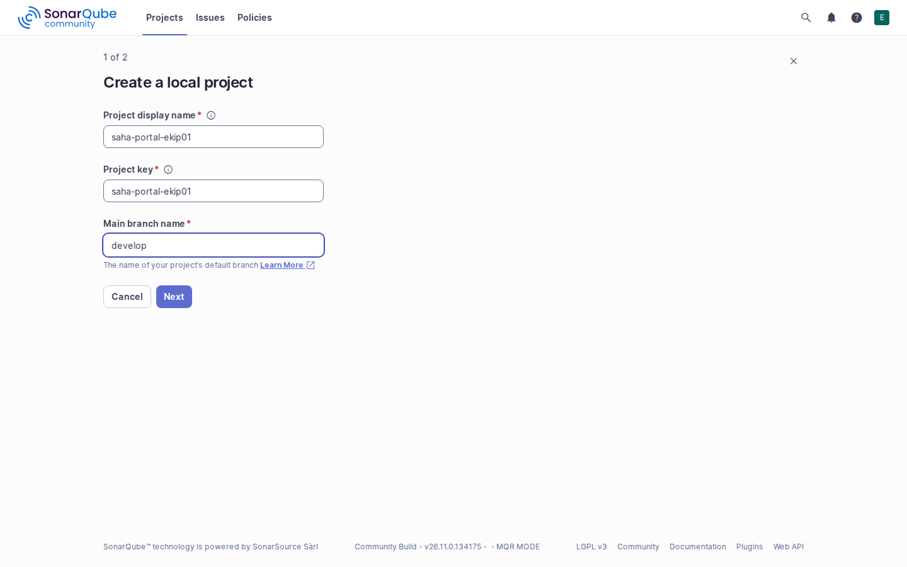
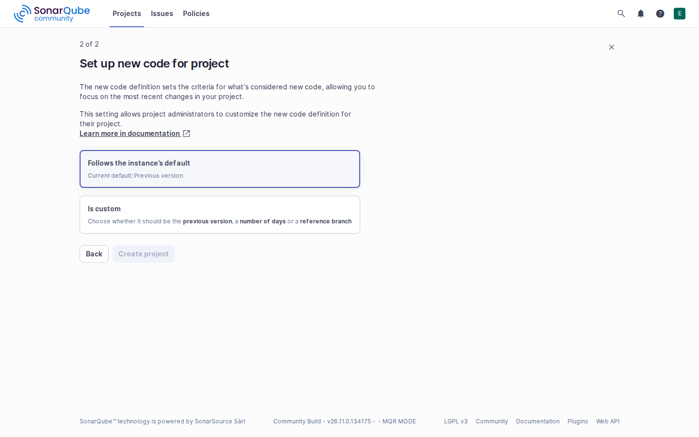
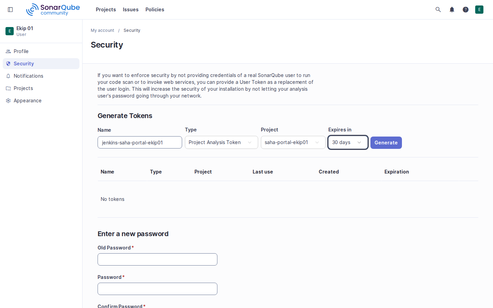
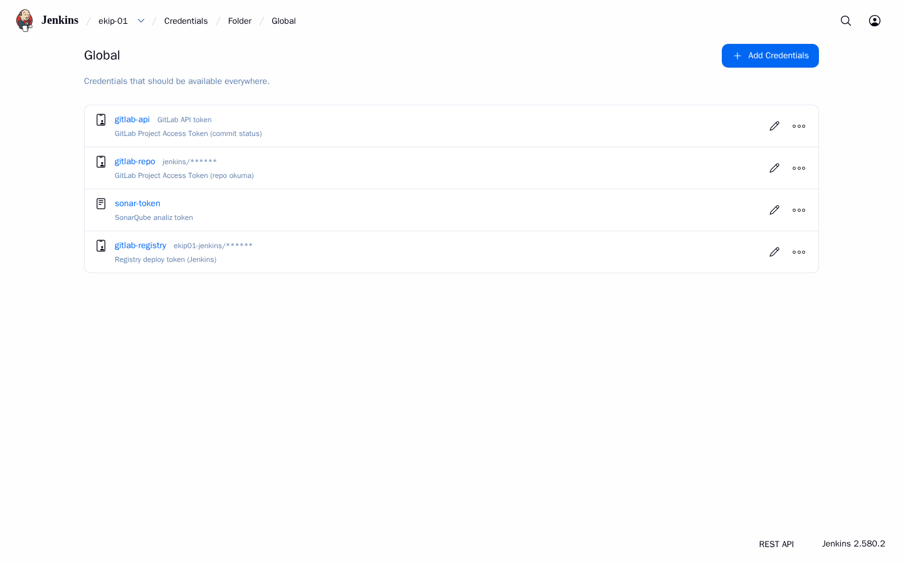
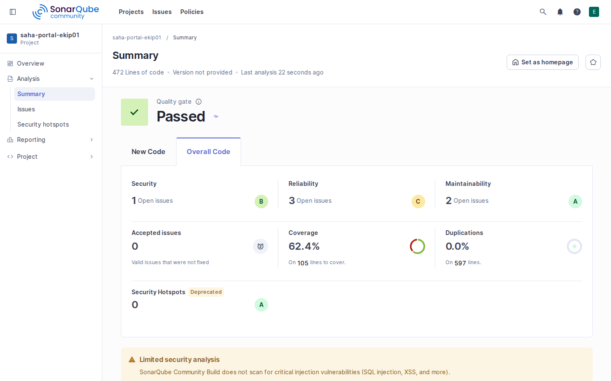
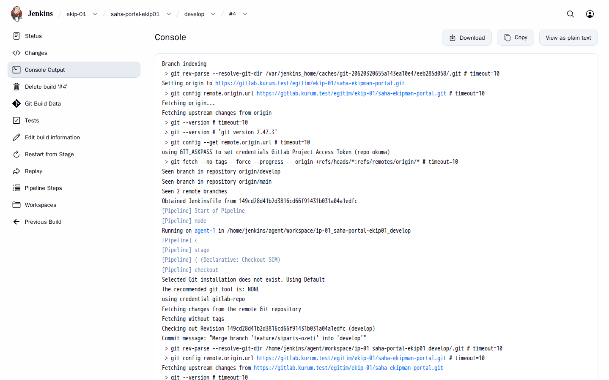
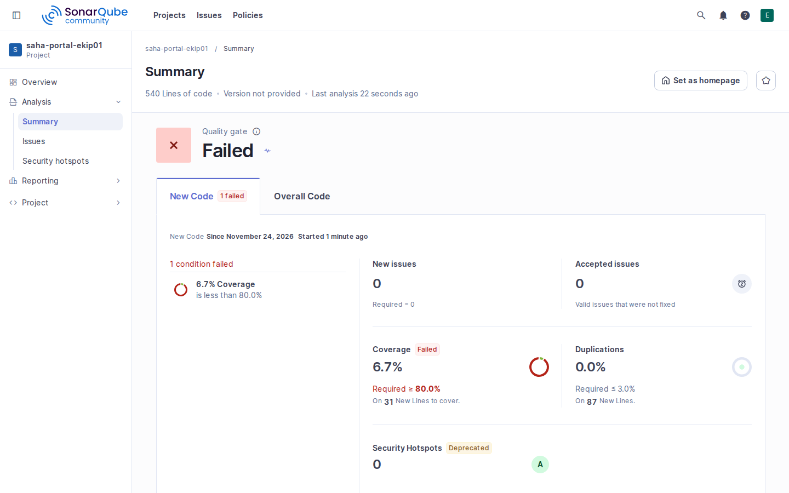
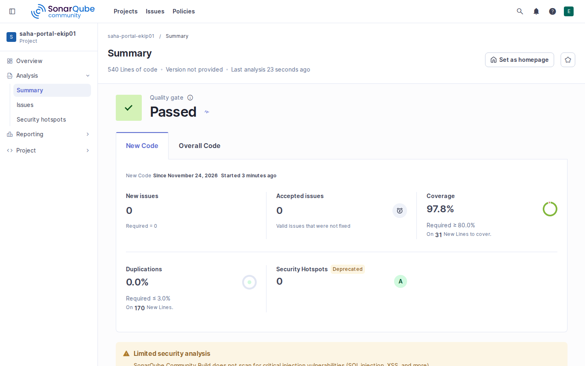
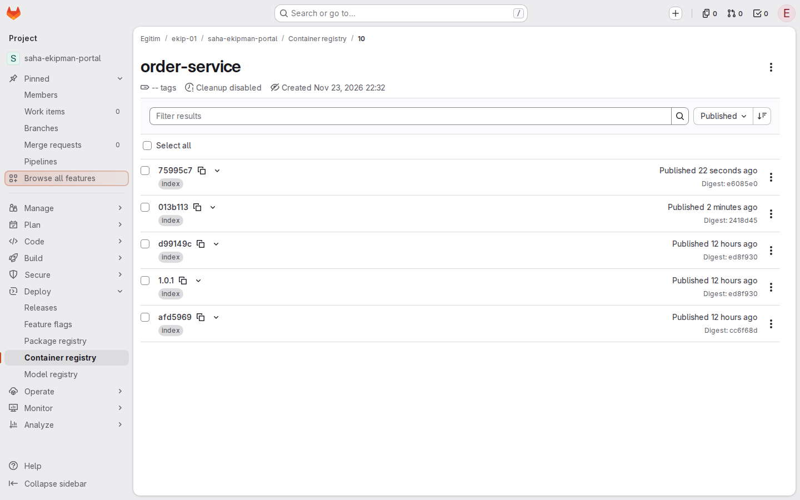

# LAB 04-B · SonarQube, Quality Gate, imaj

| | |
|---|---|
| **Gün / modül** | Gün 4 · Modül 4 |
| **Süre** | 100 dk (son 10 dk toparlama ve kontrol) |
| **Başlangıç durumu** | `checkpoint/lab-04a`: `develop` üzerinde Restore, Build, Unit Test ve web-ui stage'li `Jenkinsfile`; webhook ve "Pipelines must succeed" kurulu |
| **Takılırsan** | Quality Gate stage'i hep bekliyorsa eğitmene haber verin (SonarQube webhook'u yönetici ayarıdır). Eğitmen ekibinizi `checkpoint/lab-04b` durumuna getirebilir (bkz. bölüm 9) |

**Öğrenme kazanımı:** .NET analizini pipeline'a doğru sırayla (begin → build → test → end) taşıyabilir, Quality Gate sonucunu pipeline'ın kararına bağlayabilir, kalan bir kapıyı Jenkins ve SonarQube'da okuyup eksik testle düzeltebilir ve imajın yalnızca kapıdan geçen commit için üretildiğini gösterebilirsiniz.

Örnek değerler (prova ortamı, ekip-01):

| Değişken / ad | Örnek değer |
|---|---|
| `SONAR_URL` | `https://sonar.kurum.test` |
| SonarQube proje adı ve anahtarı | `saha-portal-ekip01` |
| SonarQube sunucu adı (Jenkins'te hazır) | `sonarqube` |
| Credential ID'leri | `sonar-token`, `gitlab-registry` (LAB 04-A'dan: `gitlab-api`, `gitlab-repo`) |
| Jenkins'in deploy token'ı | `ekip01-jenkins` |
| `IMG` | `gitlab.kurum.test:5050/egitim/ekip-01/saha-ekipman-portal` |

> **Bu ortamda SonarQube Community Build çalışır: yalnızca tek bir branch'i analiz eder.** Bu yüzden analiz ve Quality Gate **yalnızca `develop` build'inde** çalışır; feature branch'lerde build ve test yeterlidir. Sonucu: kalitesiz kod MR aşamasında değil, `develop`'a girdikten **sonra** yakalanır; kapı imajın üretilmesini engeller ama merge'ü engellemez. Bu bir Community Build sınırıdır (slayt "Lisansa göre analiz kapsamı").

## 1. Amaç

Kaliteyi düşüren commit'i pipeline durdursun: testsiz yeni kod Quality Gate'te kalsın ve imajı **üretilmesin**; testler eklenince kapı yeşile dönsün ve `develop` commit'inin imajı registry'ye gitsin.

## 2. Ön koşullar

- LAB 04-A tamam: `develop` build'i Jenkins'te yeşil; `git switch develop && git pull` temiz.
- SonarQube'a ortam kartındaki hesabınızla (`ekipNN`) girebiliyorsunuz.
- Lider GitLab'e giriş yapabiliyor (deploy token).

## 3. Kullanılacak sistemler

| Sistem | Ne için |
|---|---|
| SonarQube (ortak) | Proje, analiz token'ı, analiz sonuçları, Quality Gate |
| Jenkins (klasörünüz `ekip-NN`) | İki yeni credential; pipeline |
| İç GitLab | Deploy token, Merge Request'ler, Container Registry |
| Eğitim makinesi (terminal) | `ci/analyze.sh`, `Jenkinsfile`, testler |

SonarQube'un sonucu Jenkins'e bildiren webhook'u (`$JENKINS_URL/sonarqube-webhook/`) yönetici tarafından kurulmuştur.

## 4. Adımlar

### Adım 1 · SonarQube'da proje ve token oluştur; Jenkins'e ekle (15 dk)

**1a. Proje.** SonarQube > **Projects > Create Project > Local project**:

- **Project display name** ve **Project key:** `saha-portal-ekipNN`
- **Main branch name:** `develop`



**Next** > "Set up new code for project": **Follows the instance's default** (Previous version) > **Create project**.



**1b. Analiz token'ı.** Sağ üstte hesabınız > **My Account > Security > Generate Tokens**:

- **Name:** `jenkins-saha-portal-ekipNN`
- **Type:** `Project Analysis Token`; **Project:** `saha-portal-ekipNN`
- **Expires in:** `30 days`



**Generate**'ten sonra değer yalnızca bir kez gösterilir; kopyalayın. Bu token yalnızca bu projeye analiz gönderebilir.

**1c. Jenkins'in registry token'ı (lider).** Proje > **Settings > Repository > Deploy tokens > Add token**: ad ve kullanıcı adı `ekipNN-jenkins`, scope `read_registry` ve `write_registry`. Her tüketiciye ayrı token: Jenkins'inkini iptal etmek, dün kendi makinenizde kullandığınızı etkilemez.

**1d. Jenkins'e iki credential.** Klasörünüz > **Credentials > Folder > Global > Add Credentials**:

| ID | Tür | Alanlar |
|---|---|---|
| `sonar-token` | **Secret text** | Secret: *SonarQube token'ı* |
| `gitlab-registry` | **Username with password** | Username: `ekipNN-jenkins`, Password: *deploy token* |



### Adım 2 · begin → build → test → end adımlarını pipeline'a taşı (10 dk)

GitLab'de bir issue açın: `SonarQube analizi ve Quality Gate` (numarasını not edin).

```bash
cd ~/saha-ekipman-portal
git switch develop && git pull
git switch -c feature/sonar
```

`ci/analyze.sh` dosyasını oluşturun (slayt "SonarScanner for .NET: begin → build → test → end"). Dört komut, bu sırayla:

| Sıra | Komut | Dikkat |
|---|---|---|
| 1 | `dotnet sonarscanner begin` | Proje anahtarı: `/k:"$SONAR_PROJECT_KEY"`. Coverage raporunun yeri: `/d:sonar.cs.opencover.reportsPaths="**/coverage.opencover.xml"` |
| 2 | `dotnet build` | LAB 04-A'daki Build komutunun aynısı |
| 3 | `dotnet test` | LAB 04-A'daki komut + coverage: `--collect:"XPlat Code Coverage" -- DataCollectionRunSettings.DataCollectors.DataCollector.Configuration.Format=opencover` |
| 4 | `dotnet sonarscanner end` | |

Kurallar:

- İlk satırlar `#!/bin/sh` ve `set -eu`: bir komut başarısız olursa betik orada dursun.
- **Sunucu adresi ve token betikte yok.** Jenkins bunları `withSonarQubeEnv` bloğunda ortam değişkeni olarak verir; scanner oradan okur.
- `sonar.branch.name` göndermeyin: Community Build'de desteklenmez.
- Dosya çalıştırılabilir olmalı ve git bunu bilmeli: `chmod +x ci/analyze.sh`.

> Sıra neden önemli? Scanner derlemeyi **dinler**: build, `begin` ile `end` arasında değilse analiz boş kalır.

### Adım 3 · Quality Gate stage'ini ekle; yeşil pipeline'ı gör (20 dk)

`Jenkinsfile` içinde (slayt "Jenkinsfile: analiz ve Quality Gate", "when: koşullu Docker Build & Push"):

1. `environment` bloğuna proje anahtarını ekleyin: `SONAR_PROJECT_KEY = 'saha-portal-ekipNN'`.
2. `develop` için Build ve Unit Test'in yerini **tek bir analiz stage'i** alır; diğer branch'lerde eskisi gibi kalırlar. Var olan iki stage'e koşul ekleyin: `when { not { branch 'develop' } }`.
3. İki yeni stage (Unit Test'ten sonra, web-ui'den önce):

```groovy
stage('Build + Test + SonarQube') {
  when { branch 'develop' }
  steps {
    withSonarQubeEnv(installationName: 'sonarqube', credentialsId: 'sonar-token') {
      sh './ci/analyze.sh'
    }
  }
  post { always { junit '...' } }             // Unit Test'teki desenle aynı
}

stage('Quality Gate') {
  when { branch 'develop' }
  steps {
    timeout(time: 10, unit: 'MINUTES') {
      waitForQualityGate abortPipeline: true, credentialsId: 'sonar-token'
    }
  }
}
```

| Parça | Anlamı |
|---|---|
| `installationName: 'sonarqube'` | Yöneticinin Jenkins'te tanımladığı sunucunun adı (ortak) |
| `credentialsId: 'sonar-token'` | Analiz **sizin** token'ınızla gönderilir (ekibe özel) |
| `abortPipeline: true` | Kapı kalırsa sonraki stage'ler çalışmaz |
| `timeout` | Sonuç gelmezse pipeline sonsuza kadar beklemesin |

4. Son stage: **Docker Build & Push** (web-ui'den sonra). Dünkü dört adım: login, SHA, build, push.

Ortak agent'ta ekiplerin Docker girişleri birbirinin üzerine yazılmamalı. Mevcut `environment` bloğuna şu satırı ekleyin; dizin build context'inin dışındadır:

```groovy
DOCKER_CONFIG = "${WORKSPACE}@tmp/docker-config"
```

Pipeline'ın en dıştaki `post` bloğuna `always` ekleyin; mevcut success/failure/aborted durum bildirimlerini koruyun:

```groovy
always { sh 'rm -f "$DOCKER_CONFIG/config.json"' }
```

| Konu | Kural |
|---|---|
| Ne zaman | Yalnızca ana branch'lerde: `when { anyOf { branch 'develop'; branch 'main' } }` |
| Giriş | `withCredentials([usernamePassword(credentialsId: 'gitlab-registry', usernameVariable: 'U', passwordVariable: 'P')])`; parola komut satırına yazılmaz: `echo "$P" \| docker login $REGISTRY -u "$U" --password-stdin` |
| Etiket | Commit SHA: `SHA=$(git rev-parse --short HEAD)`. (`sh` adımı `/bin/sh` ile çalışır; `${VAR:0:7}` yazımı "Bad substitution" verir) |
| Temel imajlar | Dünkü gibi iç aynadan: `--build-arg MCR=$MCR` (iki .NET servisi), `--build-arg HUB=$HUB` (web-ui). `MCR` ve `HUB` Jenkins'te ortak ortam değişkeni olarak tanımlıdır |
| İmaj adı | `$IMG/<servis>:$SHA`; `latest` yok |

```bash
chmod +x ci/analyze.sh
git add Jenkinsfile ci/analyze.sh
git commit -m "ci: add SonarQube analysis, Quality Gate and image publishing"
git push -u origin feature/sonar
```

`feature/sonar` build'inin Console Output'una bakın: Build ve Unit Test çalıştı; üç yeni stage "skipped due to when conditional". MR açın (`Closes #<issue>`; squash açık, kaynak branch silinsin), lider merge etsin.

Şimdi `develop` build'ini izleyin: analiz gönderilir, Quality Gate stage'i sonucu bekler, imajlar push edilir.



```bash
git switch develop && git pull && git fetch --prune && git branch -D feature/sonar
```

> **Ara kontrol (45. dakika):** herkesin `develop` build'i yeşil; SonarQube'da proje "Passed". **Bu ilk analiz taban çizgisidir**: "yeni kod" bundan sonrasıdır. Ondan önce Adım 4'e geçmeyin.

### Adım 4 · Testsiz yeni kodu al (10 dk)

Şablon projede hazır bir branch var: `lab/04b-untested`. `order-service`'e bir "talep özeti" uç noktası ekler (`GET /api/orders/summary`); testi yoktur. Branch'i **merge etmeyin**; dosyalarını alıp **kendi commit'inizi** atın:

```bash
git switch -c feature/siparis-ozeti
git fetch sablon
git checkout sablon/lab/04b-untested -- src/order-service
git status --short
dotnet test tests/order-service.tests          # var olan testler geçer
git commit -m "feat(order): add order summary endpoint"
git push -u origin feature/siparis-ozeti
```

MR açın, pipeline'ı bekleyin: **yeşil**. Lider merge etsin. (Feature branch'te analiz çalışmadı; kimse bir şey fark etmedi.)

### Adım 5 · Kalan kapıyı Jenkins'te ve SonarQube'da incele (10 dk)

`develop` build'i bu kez kırmızı. Üç soruyu sırayla yanıtlayın (slayt "Başarısız pipeline nasıl okunur?"):

1. **Hangi stage kırmızı?** Jenkins > `develop` > son build.
2. **Son hata satırı ne diyor?** Console Output'un sonu.
3. **SonarQube'da hangi koşul kaldı?** Proje sayfası > "New Code".





Ayrıca bakın:

- GitLab > **Deploy > Container Registry**: bu commit'in SHA etiketi **yok**. Bir önceki `develop` commit'inin imajı duruyor.
- "Analiz görevi `SUCCESS`" ile "Quality gate `ERROR`" aynı şey değildir: ilki raporun işlendiğini, ikincisi kararı söyler.

```bash
git switch develop && git pull && git fetch --prune && git branch -D feature/siparis-ozeti
```

### Adım 6 · Eksik testleri yaz (15 dk)

```bash
git switch -c feature/siparis-ozeti-testleri
```

Yeni kod iki dosyada: `src/order-service/Services/OrderSummaryCalculator.cs` ve `Endpoints/OrderSummaryEndpoints.cs`. SonarQube'da kalan koşula ("Coverage") tıklayın: kapsanmayan satırları dosya dosya gösterir. `tests/order-service.tests/OrderSummaryTests.cs` dosyasını yazın; en az şu davranışları sınayın:

| Ne | Beklenen |
|---|---|
| `Summarize`: aynı ekipmanın talepleri (büyük/küçük harf ve boşluk farkıyla) | Tek satırda toplanır; liste toplam miktara göre azalan sıradadır |
| `Summarize`: boş ekipman kodu; negatif miktar | Boş kod sayılmaz; negatif miktar 0 kabul edilir |
| `LevelFor`: sınır değerleri (0, 1, 4, 5, 19, 20) | `none`, `low`, `low`, `medium`, `medium`, `high` (`[Theory]` + `[InlineData]`) |
| `Busiest`: boş liste; dolu liste | `null`; ilk satır |
| `GET /api/orders/summary` (var olan `OrderApiFactory` ile, iki talep oluşturduktan sonra) | `totalOrders`, `busiest` ve `products` alanları doğru |

Var olan `OrdersApiTests.cs` dosyası API testinin nasıl yazıldığını gösterir.

```bash
dotnet test tests/order-service.tests
git add tests/order-service.tests/OrderSummaryTests.cs
git commit -m "test(order): cover the order summary"
git push -u origin feature/siparis-ozeti-testleri
```

### Adım 7 · `develop`'a merge et; imajın registry'ye gittiğini doğrula (10 dk)

MR açın, pipeline yeşil olunca lider merge etsin. `develop` build'i: analiz, **Quality gate is 'OK'**, imaj push.



```bash
git switch develop && git pull && git fetch --prune && git branch -D feature/siparis-ozeti-testleri
git rev-parse --short HEAD
```

GitLab > **Deploy > Container Registry** > `order-service`: bu kısa SHA etiket olarak görünmeli.



### Toparlama (10 dk)

Bölüm 6'yı işaretleyin; bölüm 8'i yanıtlayın. Not ettiğiniz token değerlerini silin.

## 5. Beklenen çıktı

Adım 3, `feature/sonar` (kısaltılmış):

```
[Pipeline] { (Build)
[Pipeline] { (Unit Test)
Stage "Build + Test + SonarQube" skipped due to when conditional
Stage "Quality Gate" skipped due to when conditional
Stage "Docker Build & Push" skipped due to when conditional
Finished: SUCCESS
```

Adım 3, `develop` (kısaltılmış; görev kimliği ve digest'ler sizde farklıdır):

```
INFO: ANALYSIS SUCCESSFUL, you can find the results at: https://sonar.kurum.test/dashboard?id=saha-portal-ekip01
Checking status of SonarQube task 'eeb7e565-…' on server 'sonarqube'
SonarQube task 'eeb7e565-…' status is 'PENDING'
SonarQube task 'eeb7e565-…' status is 'SUCCESS'
SonarQube task 'eeb7e565-…' completed. Quality gate is 'OK'
013b113: digest: sha256:2418d455e00e… size: 856
Finished: SUCCESS
```

Adım 5, `develop`:

```
SonarQube task 'b56a5f73-…' status is 'SUCCESS'
SonarQube task 'b56a5f73-…' completed. Quality gate is 'ERROR'
Stage "web-ui" skipped due to earlier failure(s)
Stage "Docker Build & Push" skipped due to earlier failure(s)
ERROR: Pipeline aborted due to quality gate failure: ERROR
Finished: FAILURE
```

SonarQube, Adım 5: `Quality gate: Failed` · `1 condition failed` · `6.7% Coverage is less than 80.0%` (31 yeni satırdan). Adım 7: `Passed`; yeni kod coverage'ı %80'in üzerinde (çözümdeki testlerle %97,8).

## 6. Başarı kriterleri

- [ ] `ci/analyze.sh` begin → build → test → end sırasında; içinde sunucu adresi, token ya da `sonar.branch.name` yok.
- [ ] Analiz ve Quality Gate yalnızca `develop` build'inde çalışıyor; feature branch'lerde atlanıyor.
- [ ] İlk `develop` analizi yeşil (taban çizgisi) ve o commit'in imajı registry'de.
- [ ] Testsiz kod `develop`'a girdiğinde Quality Gate **kaldı**, pipeline kırmızı bitti ve o commit için imaj **üretilmedi**.
- [ ] Testler eklendikten sonra Quality Gate **geçti**; `develop`'un son commit'inin SHA etiketli üç imajı registry'de.
- [ ] Token'lar yalnızca Jenkins credential'larında; repoda yok.

## 7. Yaygın hatalar ve ipuçları

| Belirti | Olası neden | Ne yapmalı |
|---|---|---|
| Quality Gate stage'i 10 dakika bekleyip `Timeout` ile kırılıyor; SonarQube'da analiz görünüyor | SonarQube'un Jenkins'e giden webhook'u yok ya da adresi yanlış (sondaki `/` zorunlu) | Yönetici ayarıdır; eğitmene haber verin |
| `./ci/analyze.sh: Permission denied` | Dosya git'te çalıştırılabilir değil | `chmod +x ci/analyze.sh`, sonra `git add` ve commit; `git ls-files -s ci/analyze.sh` çıktısı `100755` ile başlamalı |
| Analiz başarılı ama pano boş ("no code"), coverage %0 | Build, `begin` ile `end` arasında değil ya da coverage raporu üretilmedi | Sırayı ve `dotnet test` komutundaki coverage parametrelerini denetleyin |
| Scanner: `Not authorized` / `401` / `You're not authorized to analyze this project` | `sonar-token` credential'ı yanlış; token başka projeye ait ya da iptal edilmiş | Token'ı yeniden üretin, credential'ı güncelleyin (**Update**) |
| `ERROR: SonarQube installation defined in this job (…) does not match any configured installation` | `installationName` ortam kartındaki adla aynı değil | `sonarqube` |
| `SONAR_PROJECT_KEY tanimli degil` ya da proje bulunamadı | `environment` bloğunda anahtar yok ya da SonarQube'daki anahtarla aynı değil | İkisini harf harf karşılaştırın |
| Testsiz kodu aldım ama kapı geçti | Kod, taban analizden **önce** girdi (yeni kod sayılmadı); ya da dosyaları kendi commit'inizle değil branch'i merge ederek aldınız | SonarQube > proje > **Activity**: ilk analiz hangi commit? Eğitmene danışın |
| Docker stage'i: `x509: certificate signed by unknown authority` | Agent'ın Docker daemon'ı kurum CA'sına güvenmiyor | Yönetici ayarıdır (dün kendi makinenizde yaptığınızın aynısı); eğitmene haber verin |
| Docker stage'i: `access forbidden` ya da `insufficient_scope` | `gitlab-registry` credential'ındaki token'da `write_registry` yok; kullanıcı adı token'ın kullanıcı adı değil | Adım 1c–1d |
| Docker stage'i temel imajı çekemiyor (`failed to resolve source metadata for mcr.microsoft.com…`) | `--build-arg MCR=$MCR` / `HUB=$HUB` verilmedi; build iç ayna yerine internete çıkmaya çalışıyor | Adım 3'teki tablo |
| `Bad substitution` | `sh` adımında bash'e özgü yazım | `git rev-parse --short HEAD` |
| `develop` kırmızıyken yeni MR'ım merge edilebiliyor | Doğru: MR'ın durumu kendi branch'inin son commit'inden gelir | Community Build'de kapı yalnızca `develop`'ta çalışır |

## 8. Kendini kontrol soruları

1. Testsiz kod MR'dan yeşil geçti ve `develop`'a girdi; kapı ancak ondan sonra kaldı. Bu ortamda hasarı ne sınırladı? Ticari sürümde akış nerede farklılaşırdı?
2. `withSonarQubeEnv` ile `waitForQualityGate` neden aynı pipeline çalışmasında olmak zorunda? Jenkins sonucu nasıl öğreniyor?
3. Genel coverage %70'in üzerindeyken kapı neden kaldı? "Yeni kod" neye göre belirlendi ve ilk analiz neden önemliydi?

## 9. Başlangıç durumuna dönme

**Kırmızı `develop`'u hızla yeşile döndürmek (test yazmadan):** testsiz kodu getiren merge commit'ini bir MR ile geri alın (GitLab'de merge edilmiş MR > **Revert**). Kapı yeniden geçer.

**SonarQube projesini baştan kurmak:** projeyi silme yetkisi yöneticidedir; eğitmenden isteyin. Ardından Adım 1a–1b ve `sonar-token` credential'ını yeni değerle güncelleyin; taban çizgisi için `develop` build'ini Jenkins'ten yeniden çalıştırın (**Build Now**).

**Laba baştan başlamak ya da `checkpoint/lab-04b`'ye geçmek:** eğitmen kurar. Ekip numaranızı söyleyin:

- *Baştan (`checkpoint/lab-04a`):* `develop` LAB 04-A'nın sonuna döner; SonarQube projeniz, `sonar-token` ve `gitlab-registry` credential'larınız ve `ekipNN-jenkins` deploy token'ı kaldırılır.
- *`checkpoint/lab-04b`:* `develop` çözülmüş haliyle gelir; SonarQube projesi, token ve dört credential kurulur; `develop` build'i yeşil, Quality Gate "Passed" ve imaj registry'dedir. (Checkpoint tek analizle kurulur: "önce kaldı, sonra geçti" geçmişi olmaz.) Eski çalışma kopyanız `~/yedek/` altına taşınır.
