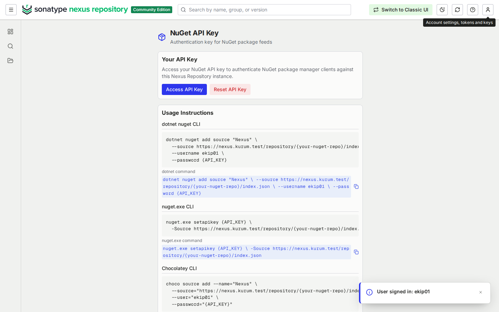
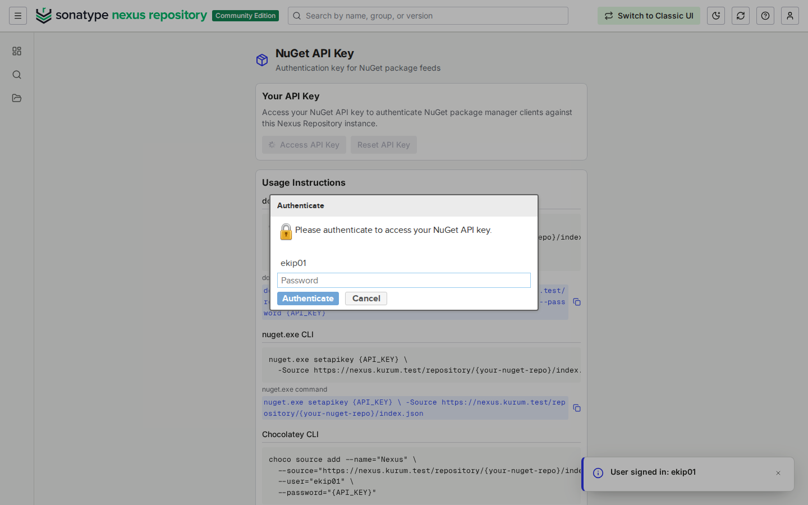
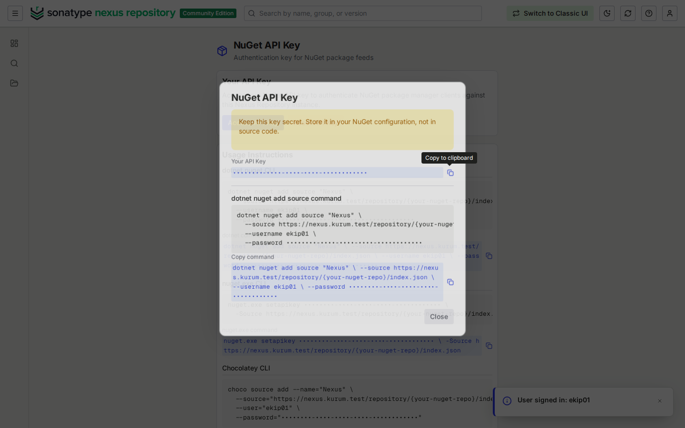
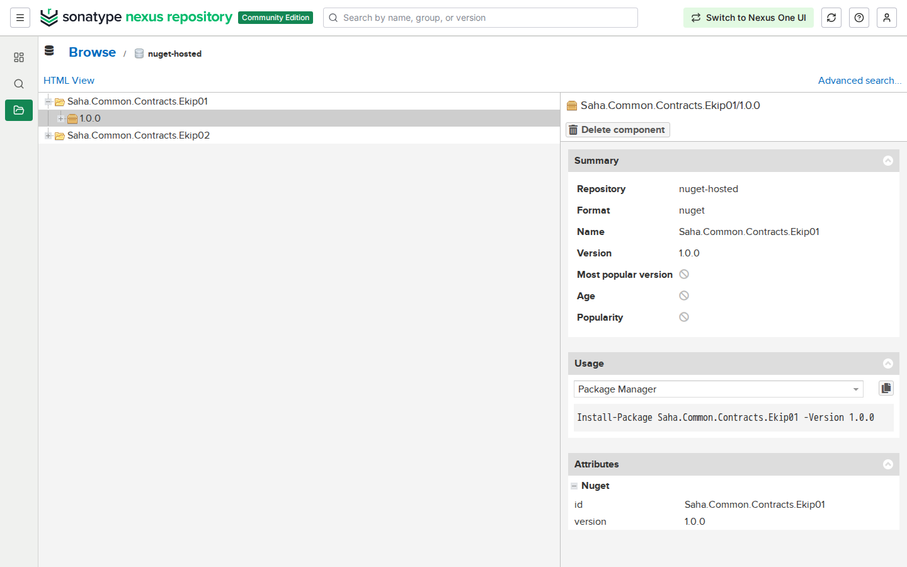

# LAB 05-A · Ortak paket Nexus'ta

| | |
|---|---|
| **Gün / modül** | Gün 5 · Modül 1 |
| **Süre** | 75 dk (son 10 dk toparlama ve kontrol) |
| **Başlangıç durumu** | `checkpoint/lab-04b`: `develop` yeşil; Quality Gate ve imaj yayını çalışıyor |
| **Takılırsan** | Restore paketi bulamıyorsa `NuGet.config`'deki kaynağa ve `<clear />` satırına bakın. Eğitmen ekibinizi `checkpoint/lab-05a` durumuna getirebilir (bkz. bölüm 9) |

**Öğrenme kazanımı:** Ortak kodu ekibe özel kimlikle sürümlü bir NuGet paketi olarak Nexus'a yayınlayabilir, yayınlanmış bir sürümün neden değiştirilemediğini açıklayabilir ve servisleri kaynak bağı yerine paketi tüketecek hale getirebilirsiniz.

Örnek değerler (prova ortamı, ekip-01):

| Değişken / ad | Örnek değer |
|---|---|
| `NEXUS_URL` | `https://nexus.kurum.test` |
| Paket kimliği (PackageId) | `Saha.Common.Contracts.Ekip01` |
| Yayın adresi (hosted) | `$NEXUS_URL/repository/nuget-hosted/` |
| Okuma adresi (group; `NuGet.config` içinde) | `$NEXUS_URL/repository/nuget-group/index.json` |
| Nexus hesabı | `ekip01` (ortam kartı) |

## 1. Amaç

`common-contracts` bugüne kadar servislerle aynı repoda bir proje olarak bağlıydı. Bu labda onu sürümlü bir paket yapıyorsunuz: sözleşme değişikliği artık yeni bir paket sürümüdür ve her servis ne zaman geçeceğine kendisi karar verir.

## 2. Ön koşullar

- LAB 04-B tamam: `develop` build'i Jenkins'te yeşil, `git status` temiz.
- Nexus'a ortam kartındaki hesabınızla (`ekipNN`) girebiliyorsunuz.
- `echo $NEXUS_URL` bir adres yazıyor; `grep -A3 packageSources NuGet.config` tek bir `nexus` kaynağı gösteriyor.

## 3. Kullanılacak sistemler

| Sistem | Ne için |
|---|---|
| Eğitim makinesi (terminal) | `dotnet pack`, `dotnet nuget push`, `.csproj` değişiklikleri, restore |
| Nexus | NuGet API anahtarı; yayınlanan paketi görmek |
| İç GitLab, Jenkins | Issue, MR, pipeline |

Nexus'taki depoları yönetici kurmuştur: `nuget-hosted` (kurum paketleri; aynı sürüm ikinci kez yayınlanamaz), `nuget.org-proxy` (dış paketlerin önbelleği) ve ikisini tek adreste birleştiren `nuget-group`. Restore group'tan, yayın hosted'a yapılır.

## 4. Adımlar

GitLab'de bir issue açın: `Ortak sözleşmeler Nexus'ta NuGet paketi olarak` (numarasını not edin).

### Adım 1 · PackageId (ekip sonekiyle) ve Version (5 dk)

```bash
cd ~/saha-ekipman-portal
git switch develop && git pull
git switch -c feature/ortak-paket
```

`src/common-contracts/common-contracts.csproj` dosyasına ikinci bir `PropertyGroup` ekleyin:

```xml
  <PropertyGroup>
    <PackageId>Saha.Common.Contracts.EkipNN</PackageId>   <!-- NN: ekip numaranız -->
    <Version>1.0.0</Version>
    <Description>...</Description>
  </PropertyGroup>
```

> **Neden ekip soneki?** Bütün ekipler aynı hosted depoya yayınlar. Hepsi `Saha.Common.Contracts 1.0.0` yayınlamaya çalışsaydı yalnızca ilk ekip başarabilirdi; ötekiler başkasının paketini kullanırdı.

### Adım 2 · `dotnet pack`; paketin içini incele (5 dk)

```bash
dotnet pack src/common-contracts -c Release -o out
ls out/
unzip -l out/Saha.Common.Contracts.Ekip$EKIP.1.0.0.nupkg
```

Paket bir zip dosyasıdır: içinde derlenmiş `common-contracts.dll` ve paketin kimlik kartı (`.nuspec`) vardır. `out/` klasörü `.gitignore`'dadır; repoya girmez.

### Adım 3 · `1.0.0`'ı Nexus hosted depoya push et (10 dk)

**3a. API anahtarı.** Nexus'a girin > sağ üstte hesap simgesi (**Account settings, tokens and keys**) > **NuGet API Key** > **Access API Key**. Nexus parolanızı yeniden sorar.





Anahtar bir pencerede gösterilir. Kopyalayın; bir dosyaya, sohbete ya da repoya yazmayın. Bu anahtar sizin hesabınız adına paket yayınlar.



**3b. Push.** Anahtarı komut satırına yazmayın; kabuk geçmişine düşer.

```bash
read -rs NEXUS_APIKEY        # anahtarı yapıştırın, Enter (ekranda görünmez)
dotnet nuget push out/Saha.Common.Contracts.Ekip$EKIP.1.0.0.nupkg \
  --source $NEXUS_URL/repository/nuget-hosted/ --api-key "$NEXUS_APIKEY"
```

Nexus'ta **Browse > nuget-hosted** altında paket klasörünüzün solundaki **+** işaretine bir kez basın; görünen **1.0.0** satırını seçin. Sağdaki Summary bölümünde paket adını ve sürümünü doğrulayın. Klasör adına çift tıklamak ağacı yeniden kapatabilir.



### Adım 4 · Aynı sürümü yeniden push etmeyi dene; hatayı oku (5 dk)

Aynı komutu bir kez daha çalıştırın. Hata alacaksınız. Mesajı okuyun: kim reddediyor, neden?

```bash
dotnet nuget push out/Saha.Common.Contracts.Ekip$EKIP.1.0.0.nupkg \
  --source $NEXUS_URL/repository/nuget-hosted/ --api-key "$NEXUS_APIKEY"
unset NEXUS_APIKEY
```

> Yayınlanmış bir sürüm numarası artık o içeriğin kimliğidir. Düzeltme gerekiyorsa `1.0.0` değiştirilmez; `1.0.1` yayınlanır.

### Adım 5 · API'lerde `ProjectReference` yerine `PackageReference` (15 dk)

İki servisin `.csproj` dosyasında (`src/order-service/order-service.csproj`, `src/product-service/product-service.csproj`) aynı repodaki projeye olan bağı paketle değiştirin (slayt "ProjectReference'tan PackageReference'a"):

```xml
<!-- önce -->
<ProjectReference Include="..\common-contracts\common-contracts.csproj" />
<!-- sonra -->
<PackageReference Include="Saha.Common.Contracts.EkipNN" Version="1.0.0" />
```

İki servisin `Dockerfile`'ında da bir satır artık gereksiz: imaj derlenirken ortak kodun kaynağı kopyalanmıyor, restore paketi Nexus'tan alıyor. Hangi satır? (`grep -n common-contracts src/*/Dockerfile`)

> Test projeleri servislere `ProjectReference` ile bağlı kalır; paket onlara servisler üzerinden gelir.

### Adım 6 · Önbelleği temizle; restore'un Nexus'tan geldiğini gör (15 dk)

```bash
dotnet nuget locals all --clear
dotnet restore SahaPortal.sln -v n | grep -i -E 'saha\.common\.contracts|Installed' | head
dotnet build SahaPortal.sln -c Release --no-restore
dotnet test SahaPortal.sln -c Release --no-build
```

Restore çıktısında paketinizin `nuget-group` adresinden indirildiğini görün. İmaj da aynı yoldan gelmeli:

```bash
docker build -f src/order-service/Dockerfile --build-arg MCR=$MCR -t ekip$EKIP-yerel/order-service:paket .
docker rmi ekip$EKIP-yerel/order-service:paket
```

### Adım 7 · MR aç; Jenkins pipeline'ının yeşil olduğunu doğrula (10 dk)

```bash
git add src/common-contracts/common-contracts.csproj src/order-service src/product-service
git status --short        # out/ listede olmamalı
git commit -m "build(contracts): consume common contracts as a NuGet package"
git push -u origin feature/ortak-paket
```

MR `feature/ortak-paket` → `develop`, açıklamaya `Closes #<issue>`. Pipeline yeşil olunca lider merge etsin. `develop` build'inde agent da paketi Nexus'tan alır: hem `dotnet restore` hem `Docker Build & Push` stage'inde.

```bash
git switch develop && git pull && git fetch --prune && git branch -D feature/ortak-paket
```

### Toparlama (10 dk)

Bölüm 6'yı işaretleyin; bölüm 8'i yanıtlayın.

## 5. Beklenen çıktı

Adım 2:

```
  Successfully created package '/home/ekip01/saha-ekipman-portal/out/Saha.Common.Contracts.Ekip01.1.0.0.nupkg'.
    Length      Date    Time    Name
       ...                      Saha.Common.Contracts.Ekip01.nuspec
      9216                      lib/net10.0/common-contracts.dll
```

Adım 3:

```
Pushing Saha.Common.Contracts.Ekip01.1.0.0.nupkg to 'https://nexus.kurum.test/repository/nuget-hosted/'...
  PUT https://nexus.kurum.test/repository/nuget-hosted/
  Created https://nexus.kurum.test/repository/nuget-hosted/ 867ms
Your package was pushed.
```

Adım 4:

```
  Conflict https://nexus.kurum.test/repository/nuget-hosted/ 56ms
error: Response status code does not indicate success: 409 (nuget-hosted/Saha.Common.Contracts.Ekip01/1.0.0 -  cannot be updated as asset already exists and redeploy is not allowed).
```

Adım 6 (kısaltılmış):

```
  OK https://nexus.kurum.test/repository/nuget-group/v3/content/saha.common.contracts.ekip01/1.0.0/saha.common.contracts.ekip01.1.0.0.nupkg 8ms
  Installed Saha.Common.Contracts.Ekip01 1.0.0 from https://nexus.kurum.test/repository/nuget-group/index.json ...
Passed!  - Failed:     0, Passed:     8, ... product-service.tests.dll (net10.0)
Passed!  - Failed:     0, Passed:    17, ... order-service.tests.dll (net10.0)
```

## 6. Başarı kriterleri

- [ ] `Saha.Common.Contracts.EkipNN` `1.0.0` Nexus'ta (`nuget-hosted`).
- [ ] Aynı sürümün ikinci yayını reddedildi (409).
- [ ] İki servis paketi `PackageReference` ile kullanıyor; `common-contracts`'a `ProjectReference` kalmadı; Dockerfile'lar ortak kodun kaynağını kopyalamıyor.
- [ ] Önbellek temizlendikten sonra restore paketi Nexus'tan indirdi; testler yeşil.
- [ ] MR merge edildi; `develop` build'i (Quality Gate ve imaj) yeşil.
- [ ] API anahtarı repoda, dosyada ya da kabuk geçmişinde yok.

## 7. Yaygın hatalar ve ipuçları

| Belirti | Olası neden | Ne yapmalı |
|---|---|---|
| Push: `401 Unauthorized` / `403 Forbidden` | API anahtarı yanlış ya da kopyalanırken eksik kaldı | Nexus'ta anahtarı yeniden görüntüleyin; `echo ${#NEXUS_APIKEY}` 36 olmalı |
| Push: `409 ... redeploy is not allowed` (ilk denemede) | Bu sürüm zaten yayınlanmış (daha önce siz ya da kimliği aynı başka biri) | `PackageId`'de ekip soneki var mı? Eğitmene danışın; sürüm silmek yönetici işidir |
| Push: `404 Not Found` | Adres group'u gösteriyor ya da sonunda `/` yok | Yayın **hosted** adrese: `.../repository/nuget-hosted/` |
| Restore: `NU1101: Unable to find package Saha.Common.Contracts.EkipNN` | Paket yayınlanmadı ya da `PackageReference`'taki kimlik/sürüm farklı | Nexus'ta adı ve sürümü karşılaştırın (büyük/küçük harf önemsizdir) |
| Restore: `NU1301` / `Unable to load the service index` | `NuGet.config` değişmiş ya da kaynak adresi yanlış | `dotnet nuget list source`; tek kaynak `nexus` olmalı |
| Derleme: `CS0246` (`CreateOrderRequest` bulunamadı) | `ProjectReference` silindi ama `PackageReference` eklenmedi | Adım 5 |
| Docker build: `COPY failed: ... src/common-contracts` yok ya da restore sırasında paket bulunamıyor | Dockerfile güncellenmedi ya da `NuGet.config` imaja kopyalanmıyor | `COPY NuGet.config ./` satırı kalmalı; ortak kodu kopyalayan satır gider |
| `git status` içinde `out/` görünüyor | `.gitignore` değişmiş | `out/` satırı `.gitignore`'da olmalı |

## 8. Kendini kontrol soruları

1. Nexus aynı sürümü neden reddetti? Bu kural olmasaydı iki ekip "1.0.0" dediğinde ne olurdu?
2. `NuGet.config`'deki `<clear />` satırı ve tek kaynak (group), kurum paketinizin adıyla dışarıda biri daha yüksek sürüm yayınlarsa sizi nasıl korur? Eksik kalan ne olabilir?
3. Sözleşmeye yeni bir alan eklemeniz gerekse, `order-service` ve `product-service` bu değişikliği hangi adımlarla, hangi sırayla alır?

## 9. Başlangıç durumuna dönme

**Değişiklikleri geri almak (henüz commit etmediyseniz):** `git restore src/ && rm -rf out/`.

**Yayınladığınız paketi silmek:** hosted depoda sürüm silmek yönetici işidir; eğitmene söyleyin. (Gerçek hayatta yayınlanmış sürüm silinmez; yenisi çıkarılır.)

**Laba baştan başlamak ya da `checkpoint/lab-05a`'ya geçmek:** eğitmen kurar. Ekip numaranızı söyleyin:

- *Baştan (`checkpoint/lab-04b`):* `develop` LAB 04-B'nin sonuna döner; Nexus'taki paketiniz silinir.
- *`checkpoint/lab-05a`:* `develop` çözülmüş haliyle gelir; paketiniz (`1.0.0`) sizin API anahtarınızla Nexus'a yayınlanır; Jenkins ve SonarQube yeniden kurulur, `develop` build'i yeşildir. Eski çalışma kopyanız `~/yedek/` altına taşınır.

## Bonus · `Pack & Publish` stage'i

Paketin elle yayını bir kez öğrenmek içindir; kalıcı düzende paket yalnızca pipeline'dan çıkar (slayt "Jenkins'ten Nexus'a yayın"). Yönetici Jenkins'te `nuget-config` adlı ortak bir dosya tanımlamıştır (kaynaklar: `nexus` = group, `nexus-hosted` = hosted). Yapılacaklar:

1. Nexus API anahtarınızı klasörünüze **Secret text** credential olarak ekleyin: ID `nexus-nuget-key`.
2. `Jenkinsfile`'a yalnızca `main`'de ve yalnızca paket klasörü değiştiğinde çalışan bir stage ekleyin:

```groovy
stage('Pack & Publish') {
  when { allOf { branch 'main'; changeset 'src/common-contracts/**' } }
  steps {
    configFileProvider([configFile(fileId: 'nuget-config', variable: 'NUGET_CFG')]) {
      withCredentials([string(credentialsId: 'nexus-nuget-key', variable: 'KEY')]) {
        sh '''dotnet pack src/common-contracts -c Release -o out
              # ... sürüm Nexus'ta varsa anlaşılır bir mesajla dur
              dotnet nuget push out/*.nupkg --configfile "$NUGET_CFG" --source nexus-hosted --api-key "$KEY"'''
      }
    }
  }
}
```

Sürüm Nexus'ta zaten varsa stage anlaşılır bir mesajla durmalı: paket klasörü değişti ama `Version` artırılmadı demektir. Varlığı denetlemek için okuma adresi yeterlidir: `$NEXUS_URL/repository/nuget-group/v3/content/<paket-kimliği-küçük-harf>/index.json` sürüm listesini döndürür.
