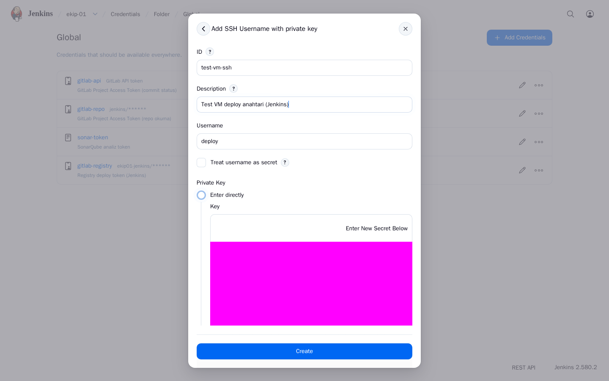
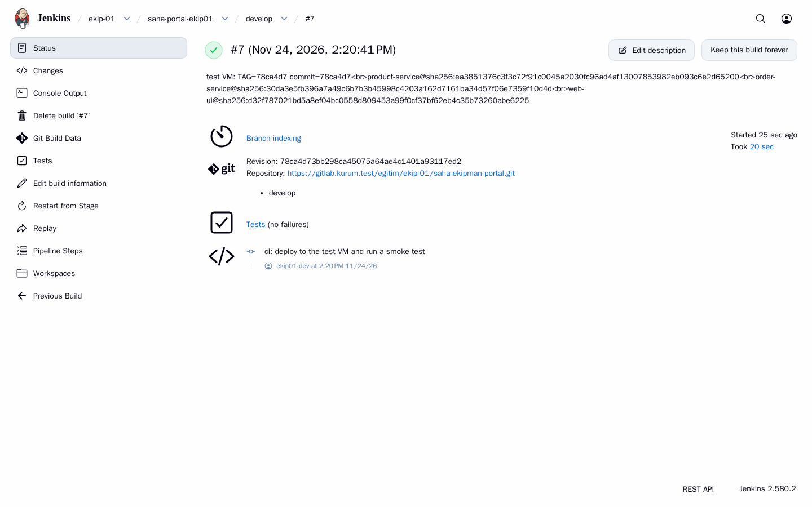
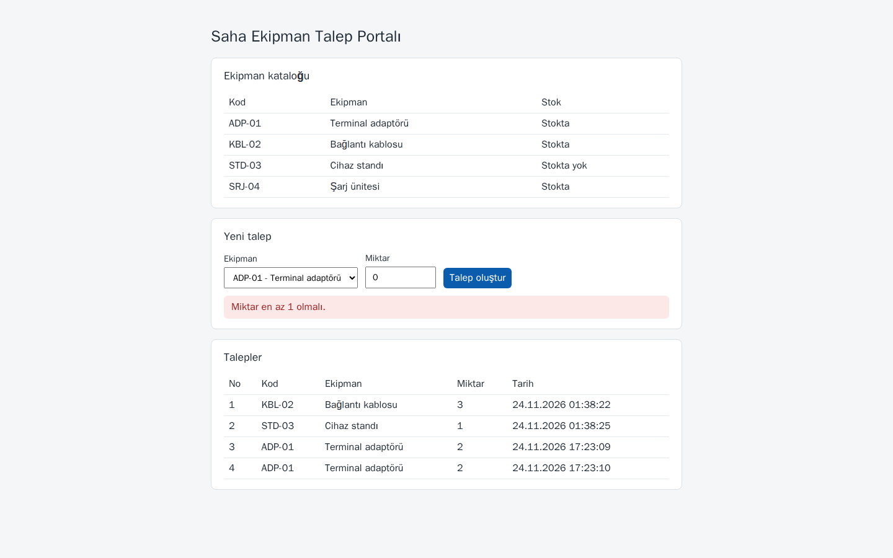
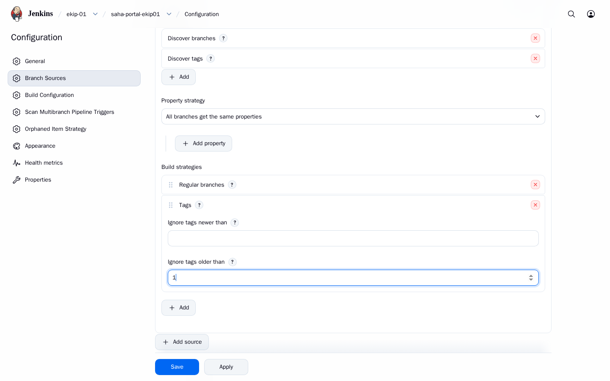
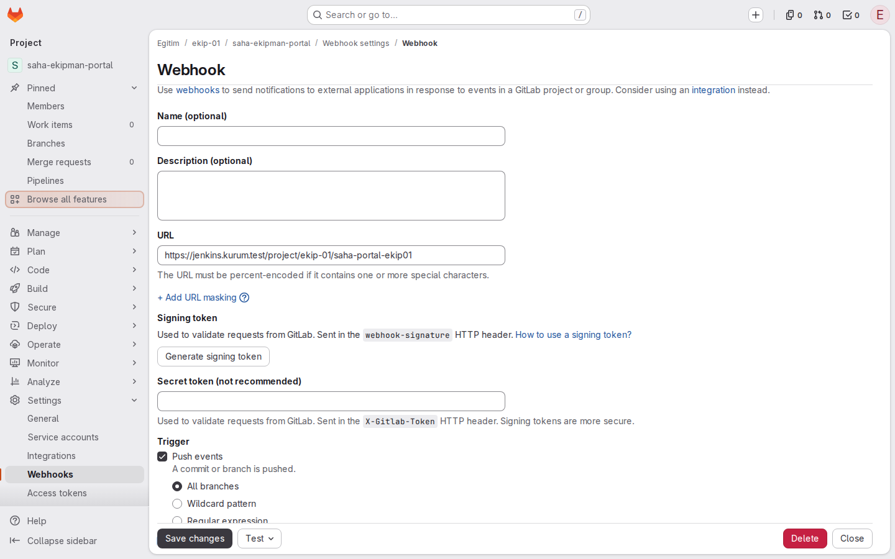
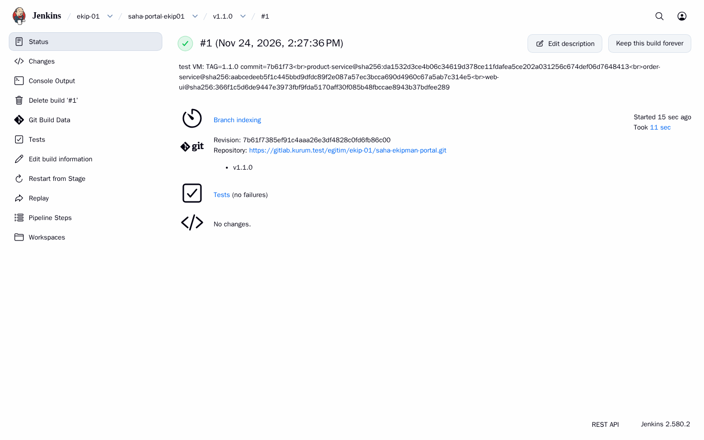
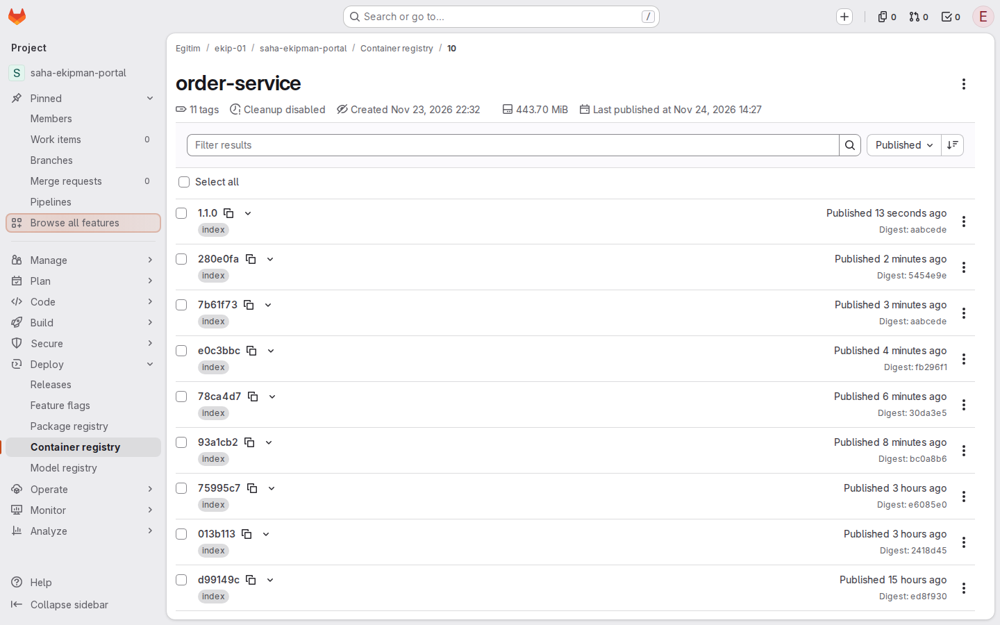

# LAB 05-B · Final: uçtan uca teslimat

| | |
|---|---|
| **Gün / modül** | Gün 5 · Modül 3 |
| **Süre** | 140 dk (son 10 dk toparlama ve kontrol; ardından ekip sunumu) |
| **Başlangıç durumu** | `checkpoint/lab-05a`: `develop` yeşil; servisler ortak paketi Nexus'tan alıyor; test VM'de `1.0.1` çalışıyor |
| **Takılırsan** | Önce kırmızı testi yaz, sonra kodu. Pipeline kırılırsa logun sonundan başla. Son çare: eğitmen ekibinizi `checkpoint/final` durumuna getirebilir (bkz. bölüm 9) |

**Öğrenme kazanımı:** Tek bir iş ihtiyacını issue'dan test ortamındaki imaja kadar bütün zincirden geçirebilir; pipeline'a otomatik deploy ve smoke test ekleyebilir; bir sürümü yeniden derlemeden etiketleyip dağıtabilir; bilinen iyi sürüme geri dönebilir ve "test ortamında hangi commit çalışıyor?" sorusunu kanıtıyla yanıtlayabilirsiniz.

**İş ihtiyacı:** "Saha personeli talep oluştururken miktar sıfır ya da negatif olamamalı." `order-service`: miktar 1'den küçükse `POST /api/orders` `400` döner; web-ui hata mesajını gösterir.

Örnek değerler (prova ortamı, ekip-01):

| Değişken / ad | Örnek değer |
|---|---|
| `TEST_VM`, `TEST_VM_USER` | `test-vm.kurum.test`, `deploy` |
| Test VM dizini, Compose projesi | `/opt/saha/ekip01`, `ekip01` |
| `WEB_PORT`, `TEST_URL` | `8081`, `http://test-vm.kurum.test:8081` |
| Credential ID'si (Jenkins'in deploy anahtarı) | `test-vm-ssh` |
| Release, tag | `release/1.1.0`, `v1.1.0` |

## 1. Amaç

Beş günde kurulan zinciri tek bir değişiklikle uçtan uca kullanmak:

```
issue → feature/12-miktar-dogrulama → MR (pipeline + review) → develop → test VM (TAG = commit SHA)
      → release/1.1.0 → main → v1.1.0 → aynı imaja 1.1.0 etiketi → test VM (TAG = 1.1.0) → rollback provası
```

**Kural:** Hiçbir adım elle atlanmaz; her adımın kanıtı GitLab, Jenkins, SonarQube, registry ve test VM'deki kayıtta görünür.

LAB 04-B’deki workspace başına `DOCKER_CONFIG` ve `post/always` temizliğini bu labda da koruyun; tag stage’i aynı izole registry girişini kullanır.

## 2. Ön koşullar

- LAB 05-A tamam: `develop` build'i yeşil, `git status` temiz.
- Test VM'de uygulamanız çalışıyor: `curl -fsS $TEST_URL/api/products | head -c 40`.
- `1.0.1` imajları registry'de (LAB 03-B): rollback provası bunlara döner.
- Lider (`ekipNN-lead`) GitLab'e girebiliyor: release merge'ü, tag ve webhook ayarı Maintainer işidir.

## 3. Kullanılacak sistemler

| Sistem | Ne için |
|---|---|
| Eğitim makinesi (terminal) | Kod, test, `Jenkinsfile`, release, tag, rollback |
| Jenkins | `test-vm-ssh` credential'ı, tag keşfi, build'ler ve deploy açıklamaları |
| İç GitLab | Issue, MR'lar, review, webhook, tag, registry |
| SonarQube | Quality Gate |
| Test VM | Uygulama (Compose), deploy kaydı (`deploy-kayit.log`) |

**Tek test ortamı:** `develop`'a giren her merge test VM'i o commit'in SHA etiketli imajıyla günceller; tag build'i ise SemVer etiketiyle. İkisi aynı ortama yazdığı için sıra önemlidir (Adım 6).

## 4. Adımlar

### Adım 1 · `Jenkinsfile`'a Deploy ve smoke test stage'lerini ekle (30 dk)

**1a. Jenkins'in deploy anahtarı.** Jenkins test VM'e SSH ile bağlanacak. Kendi anahtarınızı Jenkins'e vermeyin; yalnızca bu iş için yeni bir anahtar üretin ve test VM'de yetkilendirin:

```bash
ssh-keygen -t ed25519 -N "" -C "jenkins-ekip$EKIP" -f ~/.ssh/jenkins-test-vm
ssh-copy-id -i ~/.ssh/jenkins-test-vm.pub $TEST_VM_USER@$TEST_VM
ssh -o IdentitiesOnly=yes -i ~/.ssh/jenkins-test-vm $TEST_VM_USER@$TEST_VM hostname
```

Jenkins'te klasörünüz > **Credentials > Folder > Global > Add Credentials** > **SSH Username with private key**:

- **ID:** `test-vm-ssh`
- **Username:** `deploy`
- **Private Key > Enter directly:** `cat ~/.ssh/jenkins-test-vm` çıktısının tamamı (`-----BEGIN` ve `-----END` satırları dahil)



> Test VM'in sunucu anahtarı Jenkins agent'ına yönetici tarafından tanıtılmıştır; Jenkins ilk bağlantıda soru sormaz ve sunucu doğrulaması açık kalır.

**1b. Deploy betiği.** `deploy/deploy.sh` test VM'de çalışır; Jenkins de rollback'te siz de aynı betiği kullanırsınız. Eğitmenin verdiği dosyayı repoya ekleyin (`deploy/deploy.sh`, eğitmen çözümünde tam metni var). Ne yaptığını okuyun:

1. `docker compose pull`: hedef etiket registry'de yoksa burada durur, çalışan sürüme dokunmaz.
2. `.env` dosyasına `IMG`, `TAG`, `WEB_PORT` yazar; `docker compose up -d`.
3. `deploy-kayit.log` dosyasına bir satır ekler: zaman, etiket, commit, kaynak (Jenkins build'i ya da `elle`) ve çalışan üç imajın digest'i.

**1c. Stage'ler.** `feature/deploy` branch'i açın ve `Jenkinsfile`'a ekleyin (slayt "Deploy stage: test VM'de Compose", "Hangi olay hangi stage'i çalıştırır?"):

```bash
cd ~/saha-ekipman-portal
git switch develop && git pull --ff-only
git switch -c feature/deploy
```

```groovy
  environment {
    // ... (mevcutlar)
    TEST_VM  = 'deploy@...'            // ortam kartı
    VM_DIZIN = '/opt/saha/ekipNN'
    WEB_PORT = '...'
    TEST_URL = "http://...:${WEB_PORT}"
  }

    // Tag build'i (v1.1.0): imaj yeniden derlenmez; main build'inin SHA imajına SemVer etiketi eklenir.
    stage('Docker: SemVer etiketi') {
      when { buildingTag() }
      steps { /* login; SHA=$(git rev-parse --short HEAD); SURUM=${TAG_NAME#v}
                 her servis için: imaj registry'de mi (docker manifest inspect)? pull, tag, push */ }
    }

    stage('Deploy: test') {
      when { anyOf { branch 'develop'; buildingTag() } }
      steps {
        // develop: TAG = commit SHA; tag build'i: TAG = SemVer (TAG_NAME'in başındaki v atılır)
        sshagent(['test-vm-ssh']) {
          sh 'scp deploy/compose.yaml deploy/deploy.sh $TEST_VM:$VM_DIZIN/'
          sh 'ssh $TEST_VM "sh $VM_DIZIN/deploy.sh $IMG $DEPLOY_TAG $WEB_PORT <commit> $BUILD_URL"'
        }
        // deploy.sh'nin KAYIT satırını currentBuild.description'a yazın (düz metin: HTML işlenmez)
      }
    }

    stage('Smoke test') {
      when { anyOf { branch 'develop'; buildingTag() } }
      steps { sh 'curl -fsS --retry 10 --retry-connrefused ... $TEST_URL/api/products ...' }
    }
```

İpuçları:

| Konu | Not |
|---|---|
| Sıra | SemVer stage'i, Docker Build & Push'tan sonra; Deploy ve Smoke test en sonda |
| `options` | `disableConcurrentBuilds()`: aynı branch'in iki build'i aynı anda deploy etmesin |
| `DEPLOY_TAG` | `script { env.DEPLOY_TAG = env.TAG_NAME ? env.TAG_NAME.replaceFirst(/^v/, '') : sh(script: 'git rev-parse --short HEAD', returnStdout: true).trim() }` |
| Tag build'inde imaj yoksa | Tag'in commit'i için `main` build'i bitmemiş olabilir: kısa süre bekleyin, gelmezse **anlaşılır bir hatayla durun**; imajı yeniden derlemeyin |
| Smoke test | `curl -f` HTTP hatasında sıfır dışı döner ve stage'i kırar; hem `/api/products` hem `/api/orders` isteğinde `--retry 10 --retry-connrefused --retry-delay 3` kullanın; servisler ayrı zamanlarda hazır olur |
| `sh` | `/bin/sh` ile çalışır: `${TAG_NAME#v}` geçerlidir, `${VAR:0:7}` değildir |

```bash
git add Jenkinsfile deploy/deploy.sh
git commit -m "ci: deploy to the test VM and run a smoke test"
git push -u origin feature/deploy
```

MR `feature/deploy` → `develop` (issue'suz küçük bir altyapı değişikliği). Feature build'inde yeni stage'ler atlanır. Lider merge etsin. `develop` build'ini izleyin: Quality Gate, imaj, **Deploy: test**, **Smoke test**. Build sayfasındaki açıklamada etiket, commit ve digest'ler görünür:



```bash
VM=$TEST_VM_USER@$TEST_VM
vm() { ssh $VM "cd /opt/saha/ekip$EKIP && export DOCKER_CONFIG=/opt/saha/ekip$EKIP/.docker && $*"; }
vm "cat .env; tail -n 1 deploy-kayit.log"
```

### Adım 2 · Issue aç; `feature/12-miktar-dogrulama` (5 dk)

GitLab'de issue: `Miktarı 1'den küçük talep açılabiliyor` (numarasını not edin). Branch adı slayttaki gibi kalır:

```bash
git switch develop && git pull
git switch -c feature/12-miktar-dogrulama
```

### Adım 3 · Validation ve unit testleri yaz; lokalde doğrula (20 dk)

**Önce kırmızı test.** `tests/order-service.tests/OrdersApiTests.cs` içine iki test ekleyin (`[Theory]` + `[InlineData]`): miktar `0` ve `-1` için `400`; miktar `1` ve `2` için `201`. Var olan "boş ekipman kodu" testi örnektir.

```bash
dotnet test tests/order-service.tests     # yeni 400 testleri KIRMIZI olmalı
```

**Sonra kod.** `src/order-service/Endpoints/OrderEndpoints.cs` içinde, boş ekipman kodu denetiminin yanına: miktar 1'den küçükse `Results.BadRequest(new { error = "..." })`. Sınır değeri bir sabitte tutun.

```bash
dotnet test tests/order-service.tests     # yeşil
```

web-ui'de kod değişikliği gerekmez: API'nin `error` alanı formun altında zaten gösterilir (`src/web-ui/src/api.js`). Bunu sabitleyen test de var: `npx jest src/api.test.js`.

```bash
git add src/order-service tests/order-service.tests
git commit -m "fix(order): reject quantities below one"
git push -u origin feature/12-miktar-dogrulama
```

### Adım 4 · MR aç: pipeline ve Quality Gate yeşil, review tamam (15 dk)

MR `feature/12-miktar-dogrulama` → `develop`, açıklamaya `Closes #<issue>`. **Lider** değişikliği incelesin ve onaylasın (**Approve**), sonra merge etsin.

> Bu ortamda (SonarQube Community Build) Quality Gate `develop` build'inde çalışır; feature build'inde build ve test yeterlidir. Kapı `develop`'ta kalırsa imaj üretilmez ve deploy yapılmaz: yeni kod için test eksiktir; sınır değerlerini (0, -1, 1) test edin.

### Adım 5 · `develop`'a merge et; test VM'e otomatik deploy'u izle (10 dk)

`develop` build'i: Quality Gate yeşil → imaj → Deploy → Smoke test. Ardından:

```bash
git switch develop && git pull && git fetch --prune && git branch -D feature/12-miktar-dogrulama
vm "cat .env; tail -n 1 deploy-kayit.log"
curl -s -w ' HTTP %{http_code}\n' -X POST $TEST_URL/api/orders -H 'Content-Type: application/json' -d '{ "productId": "ADP-01", "quantity": 0 }'
curl -s -w ' HTTP %{http_code}\n' -X POST $TEST_URL/api/orders -H 'Content-Type: application/json' -d '{ "productId": "ADP-01", "quantity": 2 }'
```

Tarayıcıda `$TEST_URL` adresini açın; miktarı 0 olan bir talep deneyin:



### Adım 6 · `release/1.1.0` → `main`; `v1.1.0` tag'ini at (25 dk)

**6a. Release branch'i.** LAB 02-B'deki akışın aynısı:

```bash
git switch develop && git pull
git switch -c release/1.1.0
# CHANGELOG.md: [Unreleased] altındakileri ## [1.1.0] - <tarih> başlığına taşıyın
git commit -am "chore(release): 1.1.0"
git push -u origin release/1.1.0
```

**6b. `main`'e MR.** `release/1.1.0` → `main`: squash **kapalı**, kaynak branch **silinmesin**. Pipeline yeşil olunca lider merge etsin. `main` build'i, `main`'in yeni commit'i için SHA etiketli imajı üretir (deploy yapmaz).

**6c. Geri `develop`'a.** `release/1.1.0` → `develop` MR'ı (kaynak branch silinsin). Lider merge etsin; `develop` build'i test VM'e yeniden deploy eder.

> **Sıra neden böyle?** Test ortamı tek. Tag'i geri birleştirmeden önce atarsanız, ardından gelen `develop` deploy'u `1.1.0`'ın üzerine SHA sürümünü yazar ve test ortamında `v1.1.0` kalmaz. Önce `develop` deploy'unun bitmesini bekleyin, sonra tag atın.

**6d. Tag build'inin başlaması için iki ayar** (bir kez yapılır):

- *Jenkins (ekip):* job > **Configure** > Branch Sources > **Behaviors > Add > Discover tags**; **Build strategies > Add > Regular branches** ve **Add > Tags** (`Ignore tags older than`: `1` gün). Tag stratejisi olmadan tag'ler keşfedilir ama build'leri kendiliğinden başlamaz; "Regular branches" eklenmezse branch build'leri de durur.

  

- *GitLab (lider):* **Settings > Webhooks > Edit**: **Tag push events** işaretleyin.

  

**6e. Tag (lider).** `main`'in son commit'ine, açıklamalı tag:

```bash
rol lead
git fetch origin
git tag -a v1.1.0 -m "release: v1.1.0" origin/main
git push origin v1.1.0
```

Jenkins'te job'ın altında `v1.1.0` belirir ve build'i kendiliğinden başlar: **Docker: SemVer etiketi** → **Deploy: test** (`TAG=1.1.0`) → **Smoke test**.



### Adım 7 · `v1.1.0` imajını test ortamında smoke test ile doğrula (10 dk)

```bash
vm "cat .env; docker compose -p ekip$EKIP images"
vm "tail -n 2 deploy-kayit.log"
curl -s -w ' HTTP %{http_code}\n' -X POST $TEST_URL/api/orders -H 'Content-Type: application/json' -d '{ "productId": "ADP-01", "quantity": 0 }'
curl -s -w ' HTTP %{http_code}\n' -X POST $TEST_URL/api/orders -H 'Content-Type: application/json' -d '{ "productId": "ADP-01", "quantity": 2 }'
```

**Aynı imaj, iki etiket.** `1.1.0` ile `main` commit'inin SHA etiketi aynı digest'i göstermeli:

```bash
SHA=$(git rev-parse --short "v1.1.0^{commit}")
docker buildx imagetools inspect $IMG/order-service:1.1.0 --format '{{json .Manifest.Digest}}'
docker buildx imagetools inspect $IMG/order-service:$SHA  --format '{{json .Manifest.Digest}}'
```

GitLab **Deploy > Container Registry**'de de bakın.



### Adım 8 · Rollback provası: `1.0.1`'e dön, yeniden `1.1.0`'a çık (15 dk)

Geri dönüş yeni bir build değildir; bilinen iyi etiketi yeniden dağıtmaktır (slayt "Rollback"). Hedef etiket registry'de mi? `deploy.sh` önce `pull` eder; etiket yoksa çalışan sürüme dokunmaz.

```bash
vm "docker compose -p ekip$EKIP images"
vm "sh deploy.sh $IMG 1.0.1 $WEB_PORT - elle"
vm "docker compose -p ekip$EKIP images"
curl -s -o /dev/null -w '%{http_code}\n' $TEST_URL/api/orders/summary     # 1.0.1 bu uç noktayı bilmez: 404
```

Yeniden `1.1.0`: Jenkins'te `v1.1.0` job'ı > **Build Now**. Aynı imaj yeniden etiketlenir (digest değişmez) ve deploy edilir; kayıt bir satır daha alır.

```bash
vm "tail -n 3 deploy-kayit.log"
```

GitLab'de issue'nun kapandığını görün.

### Toparlama ve sunum hazırlığı (10 dk)

Bölüm 6'yı işaretleyin. Sunumda (slayt "Ekip sunumu: beş dakikada beş kanıt") izi gösterin: issue → MR (review, pipeline) → `develop` build'i ve Quality Gate → `v1.1.0` build'i → registry'de aynı digest → test VM'de çalışan sürüm ve `deploy-kayit.log`.

## 5. Beklenen çıktı

(Adım çıktıları ekip-01 prova koşusundan; SHA ve digest'ler sizde farklıdır. Bkz. eğitmen çözümü.)

Adım 3, kırmızı test:

```
[xUnit.net 00:00:00.58]     ...Post_order_with_quantity_below_one_returns_400(quantity: 0) [FAIL]
[xUnit.net 00:00:00.59]     ...Post_order_with_quantity_below_one_returns_400(quantity: -1) [FAIL]
Failed!  - Failed:     2, Passed:    19, Skipped:     0, Total:    21 - order-service.tests.dll (net10.0)
```

Adım 5 ve 7:

```
{"error":"Miktar en az 1 olmalı."} HTTP 400
{"id":…,"productId":"ADP-01","quantity":2,"createdAt":"…"} HTTP 201
```

Deploy kaydı (bir satır, kısaltılmış):

```
2026-11-24T14:21:01Z tag=78ca4d7 commit=78ca4d73bb29… kaynak=https://jenkins.kurum.test/job/ekip-01/job/saha-portal-ekip01/job/develop/7/ product-service@sha256:ea38… order-service@sha256:30da… web-ui@sha256:…
```

## 6. Başarı kriterleri

- [ ] `develop`'a giren her merge test VM'e otomatik deploy edildi; build açıklamasında etiket, commit ve digest var.
- [ ] Miktar doğrulaması testlerle geldi (önce kırmızı, sonra yeşil); MR review'dan geçti; Quality Gate yeşil.
- [ ] `release/1.1.0` `main`'e ve `develop`'a merge edildi; `v1.1.0` `main`'in son commit'ini gösteriyor.
- [ ] `v1.1.0` build'i imajı **yeniden derlemedi**: `1.1.0` ve SHA etiketi aynı digest'i gösteriyor.
- [ ] Test VM'de `1.1.0` çalışıyor; miktarı 0 olan talep `400`, miktarı 2 olan talep `201`.
- [ ] Rollback provası yapıldı (`1.1.0` → `1.0.1` → `1.1.0`) ve `deploy-kayit.log`'da görünüyor.
- [ ] Issue'dan imaja kadar iz gösterilebiliyor.

## 7. Yaygın hatalar ve ipuçları

| Belirti | Olası neden | Ne yapmalı |
|---|---|---|
| Deploy: `Permission denied (publickey)` | `test-vm-ssh` credential'ındaki özel anahtar eksik kopyalandı ya da açık anahtar test VM'de yetkili değil | Adım 1a; `ssh -o IdentitiesOnly=yes -i ~/.ssh/jenkins-test-vm ...` lokalde çalışıyor mu? |
| Deploy: `Host key verification failed` | Agent test VM'in sunucu anahtarını tanımıyor | Yönetici ayarıdır; eğitmene haber verin (`StrictHostKeyChecking`'i kapatmayın) |
| `No such DSL method 'sshagent'` | Plugin yok | Yönetici ayarı (SSH Agent plugin) |
| Deploy: `error from registry: access forbidden` / `pull access denied` | Test VM'de ekibin registry girişi yok ya da `DOCKER_CONFIG` ayarlanmadı | LAB 03-B Adım 6; `deploy.sh` `DOCKER_CONFIG`'i ekibin dizinine ayarlar |
| Smoke test: `curl: (22) ... 502` | Nginx ayakta ama API'ler henüz başlamadı | `--retry` ve `--retry-connrefused`; yine de kalırsa `vm "docker compose -p ekipNN logs order-service"` |
| Tag atıldı, Jenkins'te `v1.1.0` görünmüyor | Webhook'ta Tag push events kapalı ya da job'da "Discover tags" yok | Adım 6d; job > **Scan Multibranch Pipeline Now** |
| `v1.1.0` görünüyor ama build başlamadı; taramada `No automatic build triggered for v1.1.0` | "Tags" build stratejisi yok ya da tag'in commit'i 1 günden eski | Strateji ekleyin; ya da `v1.1.0` job'ında **Build Now** |
| Branch'lere push edince build başlamıyor | Build stratejileri eklenince "Regular branches" eklenmedi | Adım 6d |
| Tag build'i: `HATA: …:<SHA> registry'de yok …` | Tag `main` build'i bitmeden atıldı ya da `main` build'i kırmızı | `main` build'ini bekleyin/düzeltin; `v1.1.0` job'ında **Build Now** |
| Test VM'de `1.1.0` yerine SHA etiketi çalışıyor | Tag'den sonra `develop`'a merge yapıldı (tek test ortamı) | `v1.1.0` job'ında **Build Now** |
| Tag push reddedildi: `You are not allowed to create this tag as it is protected` | Tag'i Developer atmaya çalıştı | `v*` korumalı; tag'i lider atar (`rol lead`) |
| Quality Gate kaldı | Yeni kod için test eksik | Sınır değerleri: 0, -1, 1 |

## 8. Kendini kontrol soruları

1. `v1.1.0` build'i imajı neden yeniden derlemiyor? Yeniden derleseydi "test ettiğimiz şey çalıştırdığımız şeydir" iddiası neden zayıflardı?
2. Rollback'i mümkün kılan iki şey nedir? Veritabanı şeması değişmiş olsaydı `1.0.1`'e dönmek yeterli olur muydu?
3. Test ortamında şu an hangi commit çalışıyor? Bir dakika içinde hangi iki kaynaktan yanıtlarsınız?

## 9. Başlangıç durumuna dönme

**Test ortamını bilinen bir sürüme getirmek:** `vm "sh deploy.sh $IMG 1.0.1 $WEB_PORT - elle"` (ya da `1.1.0`).

**Tag'i yeniden atmak (yanlış commit'e atıldıysa):** korumalı tag'i lider siler: GitLab **Code > Tags** > tag > **Delete**; ardından Adım 6e.

**Laba baştan başlamak ya da `checkpoint/final`'a geçmek:** eğitmen kurar. Ekip numaranızı söyleyin:

- *Baştan (`checkpoint/lab-05a`):* `develop` LAB 05-A'nın sonuna döner; `test-vm-ssh` credential'ı, Jenkins'in deploy anahtarı ve deploy kaydı kaldırılır; test VM'de `1.0.1` çalışır.
- *`checkpoint/final`:* `develop` ve `main` son haliyle, `v1.1.0` tag'iyle gelir; Jenkins'in deploy anahtarı üretilip test VM'de yetkilendirilir, `test-vm-ssh` kurulur, tag keşfi açılır; `develop`, `main` ve `v1.1.0` build'leri çalıştırılır ve test VM'de `1.1.0` çalışır. (Checkpoint'te `v1.1.0` build'i elle başlatılır: checkpoint commit'leri sabit tarihlidir.)
